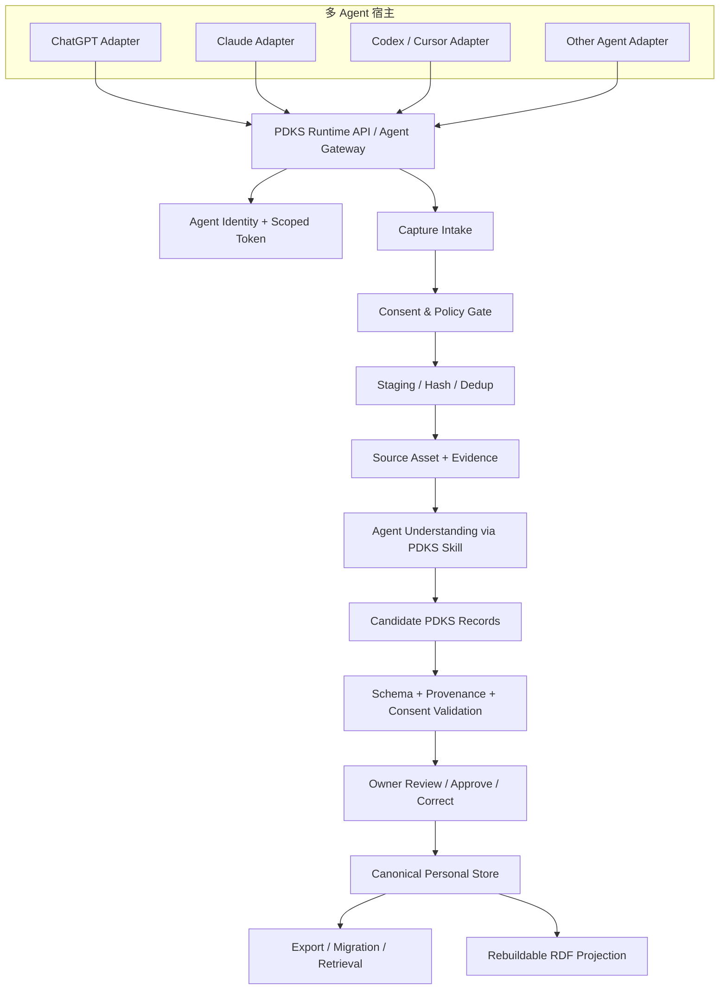

# PDKS 0.5.0：个人全域数据采集运行时架构与参考实现

> **Runtime Track 0.5.0 · Capture Runtime 0.1.0 · Agent Skill 0.3.4**
>
> 研发阶段：过渡阶段 Skill 开发（Experimental / Preview）。本版本交付可运行的本地参考实现，不是生产级个人数智底座，也不是 Personal Assistant OS。

## 0. 本轮决策摘要

用户确定了三个研发方向：

1. 首批要支持多个 Agent，而不是绑定 ChatGPT、Claude、Codex 或某个模型。
2. 数据来源设计覆盖个人工作和生活全域，而不是只围绕钉钉或会议录音。
3. 直接规划完整个人采集运行时，并在过渡阶段交付可验证的参考实现。

据此，本版本定义：

- **PDKS Skill 0.3.4**：可移植的认知规范、抽取规则、Ontology 对齐和 Agent 操作指引。
- **PDKS Capture Runtime 0.1.0**：独立的本地参考软件，负责来源接入、原始文件暂存、证据切片、授权检查、候选记录接收、校验、审核、导出和本地删除。
- **Agent Adapter**：不同 Agent 宿主的连接层；各 Agent 使用独立 token 和权限，不直接访问数据库。
- **PDKS 标准基线不变**：PDKS 0.1.0、JSON Schema 0.1.x、Ontology 0.2.1、Event Taxonomy 0.1.0 全部冻结。本版本没有发布新的稳定本体术语。

## 1. 设计目标与非目标

### 1.1 目标

- 建立多来源、跨 Agent 的统一采集入口。
- 保留原始来源、内容哈希、采集时间、事件时间、证据定位和授权引用。
- 将原始材料与 Agent 生成的候选知识分开存储。
- 默认最小权限，自动采集拒绝优先。
- 允许用户审查、确认、纠正、撤回和导出。
- 通过 API 和标准 Skill，使不同 Agent 共享同一个个人数据运行时。
- 保持 PDKS 数据可携带，避免绑定某个 Agent、模型或数据库。

### 1.2 非目标

本版本不声称已经实现：
- 钉钉、微信、企业微信、Slack、邮件、日历、网盘的原生连接器；
- 麦克风、录音卡、摄像头、定位、桌面活动、穿戴设备的后台采集；
- OCR、ASR、PDF 版面解析、视频理解；
- 远程/TLS 服务、云端托管、多设备同步；
- 生产级身份认证、密钥管理、静态加密、端到端加密；
- 生产级授权服务、合规审计和跨备份删除；
- Personal Assistant OS 或完整个人数智底座。

“全域”定义的是来源标准和未来适配范围，不代表当前无差别自动采集所有数据。

## 2. 总体架构



### 2.1 六个逻辑层

| 层 | 责任 | 0.5.0 状态 |
|---|---|---|
| Agent Host Layer | ChatGPT、Claude、Codex、Cursor 等 Agent | 宿主独立契约已定义，原生适配器待开发 |
| Agent Adapter / API Gateway | Agent 身份、Token、接口、权限和回执 | 本地 REST API、独立 Agent Token 已实现 |
| Capture Runtime | 接入、暂存、去重、证据、策略、审核、生命周期 | 本地参考实现已完成基础闭环 |
| PDKS Semantic Layer | JSON Schema、Ontology、Taxonomy、SHACL | 沿用冻结基线 |
| Personal Data Store | 原始文件、结构化记录、关系、审计 | 本地文件 Vault + SQLite |
| Lifecycle & Portability | 纠错、撤回、删除、导出、迁移 | 本地导出与来源删除原型已实现；导入和跨端删除待开发 |

### 2.2 核心架构约束

1. Agent 不直接读写 SQLite，也不直接访问 Raw Vault。
2. Runtime API 是所有 Agent 的统一数据边界。
3. Skill 不等于 Runtime；安装 Skill 不会自动获得系统连接器、设备权限或持久化。
4. PDKS JSON Record 是规范记录；Ontology 是语义契约；RDF 是可重建投影；数据库是持久化实现。
5. 向量索引（未来可选）只能是派生检索索引，不能成为事实源或唯一记忆源。
6. 用户确认与 Agent 推断必须分开保存。

## 3. 多 Agent 兼容模型

### 3.1 共享运行时，不共享数据库权限

```text
Agent A ── Token A (capture:write, records:propose) ─┐
Agent B ── Token B (capture:read, records:read) ─────┼─ Runtime API ─ SQLite / Vault
Agent C ── Token C (limited scopes) ─────────────────┘
Owner   ── Owner Token (consent, approve, delete, export)
```

每个 Agent Token：
- 绑定一个 owner_ref 和 agent_id；
- 只授予所需 scope；
- 可单独撤销；
- 不允许通过请求参数切换 owner；
- 不包含在 Skill、提示词、数据包或 Git 仓库中。

建议的 scope：
- `capture:read`
- `capture:write`
- `records:read`
- `records:propose`
- `records:approve`
- `consent:manage`
- `data:export`
- `data:delete`

普通 Agent 默认只拿 `capture:read/write`、`records:read/propose`。批准、授权、删除和导出不应默认授予通用 Agent。

### 3.2 传输方式

0.5.0 以 REST + OpenAPI 作为规范接口。不同宿主可以通过：
- 原生 HTTP/OpenAPI 工具；
- MCP Server 包装器；
- 本地 Python Client；
- 宿主专用 Plugin / Connector；
接入同一 Runtime。

本版本提供本地 HTTP API 和 Python Client，但尚未提供经过真实宿主验证的 ChatGPT、Claude、Codex、Cursor 原生适配器，也没有生产级 MCP Server。

### 3.3 重要网络限制

当前 Runtime 只监听 `127.0.0.1` / loopback。云端 Agent 不能直接访问用户电脑上的 `127.0.0.1`。要支持云端多 Agent，未来必须设计经过身份认证、TLS、密钥管理、用户授权和网络隔离的安全 Relay / Hosted Gateway；本版本不开放公网绑定，也不建议通过未经审查的端口转发暴露本地 API。

## 4. 全域数据来源标准

### 4.1 十类来源

| 来源大类 | 示例 | 推荐接入方式 | 0.5.0 状态 |
|---|---|---|---|
| 手工输入 | 日记、想法、工作日志、随手记录 | Text API / 文件 | 已实现 |
| 即时通讯 | 钉钉、微信、企业微信、Slack | 用户导出；未来只读 Connector | 手工导入 |
| 会议与语音 | 会议纪要、录音、语音备忘、访谈 | 转写文本/文件；未来 ASR | 文本导入；原始音频暂存 |
| 文档 | Word、PDF、Excel、PPT、知识库 | 文件上传/导出 | TXT/MD/CSV/JSON/HTML/EML/ICS/DOCX 可提取；PDF/Office 其他格式保留原件待解析 |
| 邮件与日历 | 邮件、会议邀请、日程 | 用户导出；未来只读 Connector | 手工导入 |
| 网页与浏览器 | 文章、网页、研究资料 | 网页剪藏/HTML | HTML 可提取 |
| 任务与项目 | 任务、项目计划、CRM、ERP | 导出/API/Webhook | 手工导入 |
| 生活事务 | 个人计划、家庭事务、消费记录 | 用户主动输入/导入 | 手工导入 |
| 设备与现场 | 图片、麦克风、摄像头、位置 | 设备 Adapter | 未实现，默认关闭 |
| 敏感个人数据 | 健康、财务、穿戴设备 | 专用 Adapter + 单独授权 | 仅定义来源类别，未接入 |

来源注册表：`runtime/pdks_capture_runtime/source-registry.json`。注册表列出的类别是目标来源范围，不代表已经存在可用连接器。

### 4.2 采集方法分级

| 级别 | 方法 | 说明 | 授权要求 |
|---|---|---|---|
| M0 | Manual Push | 用户主动粘贴、上传、导入 | 用户主动提供；不推断其他系统权限 |
| M1 | Authorized Pull | 已授权连接器读取 | 明确来源、范围、用途和期限 |
| M2 | Event Push | 系统 Webhook 推送 | 明确订阅事件与撤销机制 |
| M3 | Local Device Agent | 本机桌面、手机、设备采集 | 独立设备授权、状态指示和暂停开关 |
| M4 | Ambient Capture | 连续/环境感知 | 默认关闭，单独明确授权、可见状态和严格最小化 |

0.5.0 只实现 M0。M1-M4 是接口和路线设计，不能被描述成当前功能。

### 4.3 来源元数据

每份 Source Asset 至少保留：
- source_id / object_id；
- source_kind / source_type；
- origin_system / source_locator；
- captured_at（采集时间）；
- original_created_at / occurred_at（原始创建或事件发生时间，未知时保持未知）；
- media_type / size_bytes / content_hash；
- capture_method；
- consent_ref（适用时）；
- owner_ref；
- domain / sensitivity / access_scope；
- extractor_status；
- processing_agent / processing_version（后续派生时记录）。

不能把文件上传时间误当成事件发生时间，不能用模型猜测填补缺失的来源时间。

## 5. 采集流水线

```text
Receive
  → Authenticate Agent / Owner
  → Check Source & Consent Policy
  → Stage Raw Bytes / Compute SHA-256
  → Deduplicate / Idempotency Check
  → Extract Text (only supported formats)
  → Create Source Asset + Evidence Segments
  → Agent reads material using PDKS Skill
  → Agent submits candidate PDKS records
  → JSON Schema + Owner + Source + Consent validation
  → Owner review / correction / approval
  → Canonical local store
  → Retrieve / Export / Migration
```

### 5.1 Capture Intake

- 限制单个上传文件不超过 10 MiB。
- 原始文件按 SHA-256 内容哈希存入本地 Vault。
- 文件名只用于展示，不用于拼接任意路径。
- 不执行上传文件，不自动解压未知压缩包。
- 当前不支持的格式仍可保留原始字节，状态为 `awaiting_extractor`。

### 5.2 Extraction

当前支持文本提取：
- TXT / Markdown / CSV / JSON；
- HTML（去除 script/style 等不可见代码）；
- EML 纯文本正文；
- ICS 日历文本；
- DOCX 文本段落。

当前不内置：
- PDF 解析；
- OCR；
- ASR / 实时转写；
- 图片、视频理解；
- XLSX / PPTX 深度解析。

这些功能通过后续 Extractor Adapter 接入，不应该把原始文件上传等同于内容已经理解。

### 5.3 Evidence

- 抽取文本切成证据片段；
- 每个片段有 source_ref 和定位信息；
- 记录来源哈希与原始文件引用；
- 原始内容不因生成知识而覆盖；
- 对模型生成的摘要和事实保留来源关系。

### 5.4 Candidate / Approved 分离

Agent 只能提交 `candidate` 记录。Runtime 校验：
- PDKS 0.1.x JSON Schema；
- owner_ref；
- owner_only 访问范围；
- source_refs 是否真实存在且属于同一 owner；
- 连接器来源的 consent_ref 是否保留。

用户批准是单独动作。普通 Agent Token 不授予 `records:approve` 时不能确认记录。**Runtime 0.1.0 当前不在采集请求中执行 OWL 推理或 SHACL 图校验**；Ontology 术语和 RDF/SHACL 检查沿用现有独立工具链，后续再形成可调用的语义校验服务。

## 6. 授权、隐私与治理

### 6.1 默认拒绝自动采集

下列采集方法必须具有有效 Consent Grant：
- `api_import`
- `system_sync`
- `device_capture`

Consent Grant 需要匹配：
- owner；
- source_kind；
- purpose = `personal_knowledge_capture`；
- action = `capture`；
- data category / domain；
- 有效期限；
- 未撤销状态。

用户上传文件属于 M0，但这不代表用户有权绕过雇主保密制度、他人隐私或第三方平台条款。

### 6.2 默认数据边界

- `access_scope = owner_only`；
- 当前本地 Runtime 只接受 owner_only；
- 不自动创建企业或中心投影；
- 工作材料不得自动扩大为组织共享；
- 健康、财务、位置、音视频等敏感数据需独立来源和单独授权；
- 不默认持续录音、定位或桌面监控；
- 不采集无关旁观者信息。

### 6.3 撤销与删除

- 撤销 Consent：阻止未来采集，不等于自动删除既有数据。
- 删除 Source：本地删除原始 Blob、抽取文本、Evidence 和依赖该来源的记录正文，并保留最小 tombstone / 审计元数据。
- 本地删除回执不代表已删除外部平台、其他设备、OS 快照、云备份和历史导出包。
- 真正生产化必须建立跨副本删除传播、备份保留周期和可验证删除回执。

## 7. 数据存储与 Ontology

### 7.1 当前参考存储

| 数据 | 当前存储 | 说明 |
|---|---|---|
| 原始文件 | Content-addressed local Vault | SHA-256 文件路径；本地文件权限，不是加密 |
| Source 元数据 | SQLite | source_id、哈希、来源、时间、权限 |
| Evidence | SQLite | 证据片段和 PDKS Evidence Segment |
| Canonical PDKS records | SQLite JSON | 保留完整 PDKS JSON |
| Agent Tokens | SQLite hash | 仅保存 token 哈希 |
| Consent | SQLite | 本地原型授权登记 |
| Audit | SQLite | 操作元数据，不复制正文 |
| RDF / Graph | 现有 Ontology 工具链 | 可重建投影，不是事实源 |
| Vector Index | 未实现 | 未来可选派生索引，不能作为唯一事实源 |

### 7.2 数据库与 Ontology 的关系

Ontology 定义概念、关系、约束和语义；JSON Schema 定义记录形状；SQLite 负责事务和持久化。三者不是竞争关系。

0.5.0 沿用 SQLite 作为单用户本地原型，未来可研究 PostgreSQL / 加密对象存储 / RDF Store，但不能先用向量数据库替代规范数据层。

## 8. API 契约

OpenAPI 文件：`runtime/openapi.yaml`。

| Endpoint | 用途 | Scope |
|---|---|---|
| `POST /v1/captures/text` | 用户主动提供文本 | capture:write |
| `POST /v1/captures/file` | 上传文件 | capture:write |
| `GET /v1/captures` | 查看采集任务 | capture:read |
| `GET /v1/captures/{id}` | 查看提取结果和来源 | capture:read |
| `POST /v1/records/propose` | 提交候选 PDKS 记录 | records:propose |
| `GET /v1/records` | 查看记录列表 | records:read |
| `GET /v1/records/{id}` | 读取记录 | records:read |
| `POST /v1/records/{id}/approve` | 用户确认 | records:approve |
| `POST /v1/consents` | 建立授权 | consent:manage |
| `POST /v1/consents/{id}/revoke` | 撤销授权 | consent:manage |
| `DELETE /v1/sources/{id}` | 本地删除来源 | data:delete |
| `POST /v1/export` | 导出 PDKS Bundle | data:export |

Runtime API 默认只监听 loopback。API Token 绑定 owner 和 Agent ID；不同 Agent 应使用不同 Token。

## 9. 安装与试用

### 9.1 环境

- Python 3.10+（建议 3.11/3.12）；
- `jsonschema>=4.18,<5`；
- 本地磁盘可写目录。

### 9.2 初始化

从完整工程包根目录运行：

```bash
python -m venv .venv
# Windows: .venv\\Scripts\\activate
# macOS / Linux:
source .venv/bin/activate
python -m pip install -r runtime/requirements.txt

export PYTHONPATH=runtime
python -m pdks_capture_runtime --db ./data/pdks.sqlite3 --vault ./data/vault init --owner urn:pdks:owner:me
```

### 9.3 给一个 Agent 发最小权限 Token

```bash
python -m pdks_capture_runtime --db ./data/pdks.sqlite3 --vault ./data/vault token-create \\
  --owner urn:pdks:owner:me \\
  --agent-id agent-a \\
  --scopes capture:read,capture:write,records:read,records:propose
```

Token 只显示一次，应存入宿主 Secret Manager，不得写入 Skill、代码仓库或普通提示词。

### 9.4 启动本地 Runtime

```bash
python -m pdks_capture_runtime --db ./data/pdks.sqlite3 --vault ./data/vault serve --host 127.0.0.1 --port 8765
```

### 9.5 手工采集试用

```bash
python -m pdks_capture_runtime --db ./data/pdks.sqlite3 --vault ./data/vault capture-text \\
  --owner urn:pdks:owner:me --domain work --text "今天讨论了项目计划。"
```

### 9.6 Agent 调用

宿主需要实现 HTTP 工具映射，或使用 `runtime/pdks_capture_runtime/client.py`。本地服务不能被云端 Agent 直接通过 `127.0.0.1` 访问；远程连接器未实现。

## 10. 测试与验证

Runtime 新增 22 项自动化测试，覆盖：
- 手工文本和文件采集；
- Source Asset / Evidence Schema 校验；
- 幂等与内容去重；
- 自动采集无授权拒绝；
- 授权来源、领域、撤销校验；
- 文件大小限制和 HTML 安全抽取；
- 候选记录来源验证和 owner 边界；
- 用户审批；
- 来源删除与依赖记录正文清理；
- Bundle 导出与哈希校验；
- Agent Token Scope 与撤销；
- HTTP API 调用。

测试命令：

```bash
python -m unittest discover -s runtime/tests -v
```

## 11. 当前成熟度与能力声明

| 能力 | 状态 |
|---|---|
| 手工文本采集 | `prototype_local` |
| 手工文件采集 | `prototype_local` |
| 基础文本抽取 | `prototype_partial` |
| 本地 SQLite 持久化 | `prototype_local` |
| Source / Evidence 溯源 | `prototype_local` |
| Schema 校验与候选记录 | `prototype_local` |
| 本地授权登记和 Scope Token | `prototype_local` |
| 多 Agent 共享本地 API | `prototype_partial` |
| 原生钉钉 / 微信连接器 | `not_implemented` |
| OCR / ASR / PDF 解析 | `not_implemented` |
| 设备持续采集 | `not_implemented` |
| 远程/TLS、多设备同步 | `not_implemented` |
| 生产级加密和密钥管理 | `not_implemented` |
| 生产级授权和删除闭环 | `not_implemented` |

## 12. 后续路线

### 0.5.1 — Runtime Hardening
- 修复错误处理、事务边界和迁移机制；
- 加强导出导入、备份恢复和删除测试；
- 设计加密存储与本地身份边界；
- 完成 API 契约和 Agent Adapter 一致性测试。

### 0.6.0 — First Read-only Connectors
- 优先钉钉导出/授权只读接入；
- 邮件、日历、云文档适配器；
- 同步游标、增量拉取、重试、速率限制；
- 每个连接器独立授权和撤销。

### 0.7.0 — Multimodal Extraction
- ASR 会议语音转写；
- OCR 图片/扫描件；
- PDF / Office 提取；
- 证据时间戳、页码、帧和片段定位。

### 0.8.0 — Secure Multi-Agent Runtime
- 多 Agent 原生 Adapter / MCP；
- 安全 Relay、TLS、身份认证、密钥管理；
- Agent 隔离、策略审计和多端同步研究。

### 0.9.0 — Personal Context & Life OS Prototype
- 跨来源事件关联；
- 工作/生活时间线；
- 持续上下文和可解释记忆；
- 用户纠错反馈闭环。

### 进入正式个人数智底座阶段的前置条件
必须完成真实授权来源的连接器试点、数据删除和恢复演练、加密与身份设计、安全评审、跨 Agent 实测和用户可用性验证。当前 0.5.0 不满足这些条件。

## 13. 最终判断

**PDKS 不是一个让用户手工维护的知识库，而是个人数据的统一语义和迁移标准。Capture Runtime 是未来个人数智底座的数据入口与生命周期底层；Agent 是可替换的理解和交互界面。**

本版本已经实现“用户主动输入/上传 → 本地暂存 → 证据 → Agent 候选记录 → 校验 → 用户确认 → 持久化/导出/本地删除”的最小闭环。

但它仍然是过渡阶段参考工程：尚未实现全域自动连接、后台感知、生产安全、多设备和 Personal Assistant OS。
