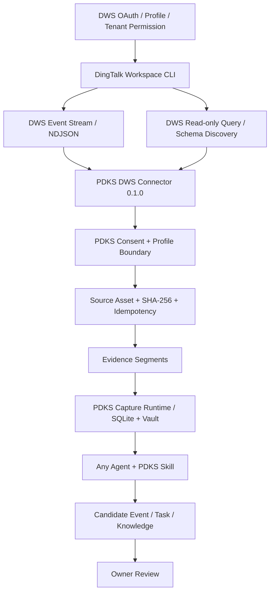

# PDKS 0.5.1：DWS 官方 CLI 接入适配器设计与参考实现

> **Runtime Track 0.5.1 · Capture Runtime 0.1.1 · DWS Connector 0.1.0 · Agent Skill 0.3.4**
>
> 研发阶段：过渡阶段 Skill 开发（Experimental / Preview）。本版本交付本地参考实现，不是生产级个人数智底座，也不是 Personal Assistant OS。

## 0. 本轮决策

将钉钉官方 DingTalk Workspace CLI（`dws`）作为 PDKS 的第一个真实数据来源适配器。

- DWS：负责使用当前钉钉用户 OAuth 身份访问钉钉能力、查询和订阅事件。
- DWS Connector：负责以安全子进程调用 DWS、解析 NDJSON、验证 profile 与 PDKS 授权、转换来源元数据。
- PDKS Capture Runtime：负责原始数据暂存、哈希、幂等、Evidence、权限、生命周期与持久化。
- PDKS Ontology / Skill：负责统一语义和指导 Agent 理解，不把钉钉字段直接升级为 PDKS 本体术语。

版本边界：

| 模块 | 版本 | 状态 |
|---|---|---|
| PDKS Runtime Track | 0.5.1 | 过渡阶段研发 |
| Capture Runtime | 0.1.1 | 本地参考实现 |
| DWS Connector | 0.1.0 | 本地参考实现，等待真实账号验收 |
| Agent Skill | 0.3.4 | 不变 |
| PDKS Standard | 0.1.0 | 冻结 |
| JSON Record Schema | 0.1.x | 冻结 |
| Ontology | 0.2.1 | 冻结 |
| Event Taxonomy | 0.1.0 | 冻结 |

## 1. 官方 DWS 能力与边界

官方仓库：<https://github.com/DingTalk-Real-AI/dingtalk-workspace-cli>

官方中文文档：<https://github.com/DingTalk-Real-AI/dingtalk-workspace-cli/blob/main/README_zh.md>

DWS 是钉钉官方面向用户和 AI Agent 的工作台 CLI。官方命令目录列出 13 个产品模块和 180 条命令。官方个人事件目录列出 33 个事件类型。目录存在不代表某个企业已开通该事件投递；需要在目标企业、账号和平台环境实际验收。DWS EventKey 只作为来源系统事件标识，不新增或替代 PDKS Event Taxonomy 术语。

### 1.1 两类接入路径

**A. 实时事件流**

- `dws event consume <event_key> --flatten -f ndjson`
- 普通 IM 场景官方也提供 `dws event +listen-im` 便捷命令。
- stdout：每行一个 NDJSON 事件。
- stderr：ready、订阅 ID、退出原因和诊断信息。
- `event consume` 是阻塞进程；退出时应优雅清理本次新建的订阅。
- `--duration` / `--max-events` 可用于有限时长和验收。

**B. 历史查询 / 资料补充**

官方目录提供只读命令，例如：
- `dws chat message list-all`
- `dws chat message list`
- `dws minutes list all`
- `dws minutes get summary`
- `dws minutes get transcription`
- `dws calendar event list`
- `dws todo task list`
- `dws oa approval detail`

各命令参数以当前安装版 `dws schema "<command path>" --compact` 和具体命令 `--help` 为准。Connector 0.1.0 已实现只读 Schema 发现入口，但**尚未实现完整历史分页回填器**。

### 1.2 33 个个人事件类型

| 分类 | 数量 | PDKS 典型用途 |
|---|---:|---|
| IM 消息、已读、撤回、回应、群生命周期 | 16 | 工作沟通与协作事件 |
| OA 审批任务与实例 | 7 | 决策、审批、流程状态 |
| VoIP 来电邀请 | 1 | 沟通活动线索 |
| Todo 创建、更新、删除 | 3 | 任务与承诺 |
| 好友申请、好友建立 | 2 | 关系线索 |
| 互动卡片回调 | 1 | 业务交互 |
| AI 听记创建、纪要生成 | 2 | 会议和知识沉淀 |
| 主日历变化 | 1 | 工作时间线 |
| **合计** | **33** | |

重要限制：
- 当前用户身份由 DWS OAuth 登录态决定，不允许 PDKS 伪造用户身份。
- 日历事件只覆盖当前用户主日历，并且不补发历史。
- 日历事件在 CLI 目录中可见不代表租户已开通；创建、修改、取消的端到端投递必须单独验收。
- 听记事件本身不包含纪要正文；收到 `user_minutes_summary_generated` 后，需要通过 `dws minutes get summary --id <task_uuid>` 另行读取。
- DWS 的部分消息媒体只提供可读描述；媒体原件下载需要单独调用对应命令。
- DWS 目录支持不等于账号权限、租户配置和数据授权均已具备。

## 2. 总体架构



### 2.1 核心约束

1. PDKS 只通过官方 DWS CLI 访问钉钉，不自行重写钉钉 API。
2. 通过 `subprocess` 参数数组执行，不使用 shell 拼接命令。
3. DWS profile 必须明确选择；一个 profile 是稳定的 `corpId:userId` 身份。
4. 启动消费前检查 PDKS Consent、DWS 登录快照、profile 和事件 Schema。
5. 仅允许已审查的只读命令；不开放发送消息、修改日历、审批、建任务等写命令。
6. 事件流输出使用 `--flatten -f ndjson`，只从 stdout 读取业务事件；stderr 只用于生命周期诊断。
7. 原始事件先保存为 PDKS Source Asset，不自动推断或批准 Event / Task / Knowledge。
8. 重复事件使用稳定来源标识和幂等键；日历与听记事件优先使用 DWS 文档规定的 `biz_id`。
9. 采集时间、事件发生时间和平台时间戳分开；未知时间不由模型猜测。
10. DWS 原始数据、用户授权和 Agent 生成的知识分层存储。

## 3. DWS Connector 0.1.0 实现

代码位置：`runtime/pdks_capture_runtime/connectors/dws/`

### 3.1 DWS CLI Wrapper

`DWSCLI` 当前实现：
- `dws version`
- `dws auth status --readonly --format json`
- `dws event list --format json`
- `dws event schema <event_key> --flatten --format json`
- `dws schema "<approved read-only command>" --compact --format json`
- `dws minutes get summary --id <task_uuid> --format json`

安全约束：
- 不执行任意命令字符串。
- 不使用 `shell=True`。
- 认证状态结果使用字段 allowlist，不返回 token / secret。
- 历史回填 Schema 只允许已审查的只读命令路径。
- 不读取 DWS 本地 Keychain 或 token 文件；认证由 DWS 自己管理。

### 3.2 NDJSON Stream Consumer

`DWSConsumer` 当前实现：
- 使用独立子进程启动 `dws event consume`。
- 解析官方 stderr ready marker，等待真正 ready，不用固定 sleep 猜测。
- 记录订阅 ID。
- stdout 一行一条 JSON；拒绝非对象、非法 JSON 和超过 1 MiB 的单行。
- 使用线程分别排空 stdout / stderr，避免管道阻塞。
- 退出时关闭 stdin，必要时发送 POSIX SIGTERM 或 Windows CTRL_BREAK_EVENT，给 DWS 执行订阅清理的机会。
- 不调用 `kill -9`，不自动执行 `event stop --all --yes`。
- 支持有限时长或最大事件数的验收模式。

多事件组合遵循 DWS 的兼容性约束。若一行扁平事件不能明确映射到所配置的 EventKey，Connector 会拒绝猜测；首轮实测建议每个消费者使用一个 EventKey。

### 3.3 PDKS Source Mapping

每条 DWS 事件转换为一个 PDKS Source Asset：

| PDKS 字段 | 映射 |
|---|---|
| `source_kind` | `dingtalk` |
| `origin_system` | `dingtalk_dws_cli` |
| `capture_method` | `system_sync` |
| `source_locator` | `dws://<profile>/<event_key>/<stable-id>` |
| `domain` | `work` |
| `sensitivity` | 默认 `personal_work`，可显式提高 |
| `consent_ref` | 用户在 PDKS 建立的有效授权 |
| `occurred_at` | 仅接收明确 ISO-8601 字符串；毫秒时间戳原样留在源事件 JSON |
| `content_hash` | Runtime 计算 SHA-256 |
| `idempotency_key` | owner + profile + event key + 稳定事件 ID 的 SHA-256 |

事件 ID 规则：
- Calendar：优先 `biz_id`（官方说明它是日历事件幂等业务 ID）。
- Minutes：优先 `biz_id`。
- 其他事件：优先 `event_id`，然后使用 `task_id` / `task_uuid` / `message_id` 等稳定字段。
- 无稳定 ID 时使用规范化 JSON 的 SHA-256。

来源原件保留完整扁平事件 JSON。此版本不把所有消息字段硬编码成 PDKS Event 属性；由 Agent 按 Skill 和 Ontology 生成候选记录。

### 3.4 会议纪要补充读取

`user_minutes_summary_generated` 只通知纪要已生成，不携带完整正文。Connector 提供显式命令：

```bash
pdks-runtime dws-minutes-summary \
  --owner urn:pdks:owner:me \
  --consent-ref <PDKS_CONSENT_REF> \
  --profile <corpId:userId> \
  --task-uuid <task_uuid>
```

该操作会再次校验授权，再使用 DWS 只读命令获取摘要并作为独立 Source Asset 保存。转写全文读取和音视频原件下载尚未自动化。

## 4. 授权和隐私

### 4.1 双重授权

必须同时满足：

1. **DWS 授权**：用户通过 `dws auth login` 登录；企业管理员已启用 CLI 访问；当前用户有权读取目标数据和订阅对应事件。
2. **PDKS 授权**：个人在 PDKS 中为 `source_kind=dingtalk`、`domain=work` 建立有效 Consent Grant。

任何一方缺失都不能采集。

### 4.2 默认策略

- 默认只采集工作域 `work`。
- 默认敏感级别 `personal_work`；企业限制材料需按组织政策提升敏感级别或禁止个人留存。
- 不默认订阅所有单聊和群聊；用户必须明确选择事件范围。
- 不自动采集无关群成员、旁观者或其他用户的数据。
- 不在日志、命令行输出、Skill 文件或 Git 中保存 OAuth token / App Secret。
- DWS `auth status --readonly` 只读检查本地登录快照，不刷新 token。
- 撤销 PDKS Consent 后阻止后续采集；既有数据删除需单独执行来源删除流程。
- 用户所在企业的保密、数据留存和个人信息政策优先于技术能力。

### 4.3 不采集的写操作

Connector 0.1.0 的允许命令只包括身份状态、事件目录、Schema、事件消费和显式纪要摘要读取。下列操作不在 Connector 的允许列表：
- 发送或撤回聊天消息；
- 创建、更新或删除日历；
- 创建、修改或删除待办；
- 审批、拒绝、转交或撤销 OA；
- 上传、移动或删除文件；
- 修改听记摘要或标题。

## 5. 安装与试用

### 5.1 安装 DWS

macOS / Linux：

```bash
curl -fsSL https://raw.githubusercontent.com/DingTalk-Real-AI/dingtalk-workspace-cli/main/scripts/install.sh | sh
```

Windows PowerShell：

```powershell
irm https://raw.githubusercontent.com/DingTalk-Real-AI/dingtalk-workspace-cli/main/scripts/install.ps1 | iex
```

DWS 安装器可同时安装钉钉自己的 Agent Skills；它们与 PDKS Skill 是两套不同能力，互不替代。PDKS Skill 0.3.4 仍需按原有跨 Agent 安装方式独立安装。

也可以使用 npm：

```bash
npm install -g dingtalk-workspace-cli
```

### 5.2 登录和确认身份

```bash
dws version
dws auth login
dws auth status --readonly --format json
dws profile list
```

如组织未开启 CLI 访问，需要向企业管理员申请。自动化应使用 `dws profile list` 返回的精确 `corpId:userId`，不要用重名的组织名或用户名代替。

### 5.3 安装 PDKS Runtime

在 PDKS 完整工程包根目录：

```bash
python -m venv .venv
# Windows PowerShell: .venv\\Scripts\\Activate.ps1
# macOS / Linux:
source .venv/bin/activate
python -m pip install -e runtime
```

初始化 PDKS 个人数据区：

```bash
pdks-runtime --db ./data/pdks.sqlite3 --vault ./data/vault init \
  --owner urn:pdks:owner:me
```

创建钉钉工作域授权：

```bash
pdks-runtime --db ./data/pdks.sqlite3 --vault ./data/vault consent-create \
  --owner urn:pdks:owner:me \
  --source-kind dingtalk \
  --domain work \
  --note "允许 DWS 只读采集本人钉钉工作数据"
```

保存返回的 `consent_ref`。不要将其提交到 Git。

### 5.4 连接诊断与 Schema 检查

```bash
pdks-runtime --db ./data/pdks.sqlite3 --vault ./data/vault \
  dws-doctor --profile <corpId:userId>

pdks-runtime --db ./data/pdks.sqlite3 --vault ./data/vault \
  dws-event-catalog

pdks-runtime --db ./data/pdks.sqlite3 --vault ./data/vault \
  dws-event-schema --event-key user_im_message_receive_at
```

### 5.5 首次安全试采集

先从范围较小的 @ 我消息事件开始：

```bash
pdks-runtime --db ./data/pdks.sqlite3 --vault ./data/vault \
  dws-consume \
  --owner urn:pdks:owner:me \
  --consent-ref <PDKS_CONSENT_REF> \
  --profile <corpId:userId> \
  --event-key user_im_message_receive_at \
  --max-events 3 \
  --duration 5m
```

验收通过后，再单独选择需要的事件类型。示例：

```bash
# 全部单聊消息（范围较广，需要单独明确授权）
pdks-runtime ... dws-consume --owner ... --consent-ref ... \
  --profile <corpId:userId> \
  --event-key user_im_message_receive_o2o_all

# 全部群聊消息（范围较广，需要单独明确授权）
pdks-runtime ... dws-consume --owner ... --consent-ref ... \
  --profile <corpId:userId> \
  --event-key user_im_message_receive_group_all

# 待办变化
pdks-runtime ... dws-consume --owner ... --consent-ref ... \
  --profile <corpId:userId> \
  --event-key user_todo_task_create \
  --event-key user_todo_task_update \
  --event-key user_todo_task_delete \
  --role-types creator,executor,participant

# 会议纪要生成事件
pdks-runtime ... dws-consume --owner ... --consent-ref ... \
  --profile <corpId:userId> \
  --event-key user_minutes_summary_generated
```

多事件组合必须满足 DWS 事件兼容规则，并且每条事件输出都能明确映射 EventKey。无法识别时 Connector 会拒绝猜测。首轮验收建议单事件运行。

持续监听时省略 `--max-events` 和 `--duration`，按 Ctrl+C 优雅停止。当前命令以前台进程运行，需要保持终端开启；尚未实现系统服务、开机自启、后台守护、崩溃自动重启和持久化同步游标。DWS CLI 自身的 Stream 重连能力与 PDKS 进程监督是两件不同的事。

## 6. 历史回填策略

DWS 具备历史查询命令，但实时事件不等于历史回放。建议历史回填单独设计为第二个子模块：

1. 先通过 `dws schema "<command path>" --compact` 发现当前安装版参数。
2. 使用只读历史命令，明确时间范围、分页和数据类别。
3. 记录 profile、查询时间窗、分页游标和 DWS 命令版本。
4. 按 DWS 原始 message / task / calendar / minutes ID 建立幂等来源。
5. 对历史数据与实时事件做去重和时间窗重叠核对。
6. 不因查询失败自动扩大时间范围或读取其他用户的数据。

Connector 0.1.0 提供 `dws-command-schema` 只读 Schema 发现，但没有自动执行历史分页回填。下一版本应先在真实账号中验证各命令的分页参数、数据范围和搜索权限，再实现导入器。

## 7. 已实现、未实现和验收状态

| 能力 | 当前状态 |
|---|---|
| DWS CLI 存在性 / 版本检查 | `prototype_local` |
| 只读 OAuth 状态检查 | `prototype_local` |
| 显式 profile 选择 | `prototype_local` |
| 33 个事件键目录 | `prototype_catalog` |
| 事件 Schema 查询 | `prototype_local` |
| NDJSON 子进程消费 | `prototype_local` |
| Ready marker / subscribe ID / 优雅退出 | `prototype_local` |
| 前台持续监听 | `prototype_local` |
| PDKS 后台守护 / 自动重启 / 持久化游标 | `not_implemented` |
| PDKS Consent 门禁 | `prototype_local` |
| DWS Source Asset / Evidence / 幂等 | `prototype_local` |
| 听记摘要显式补充读取 | `prototype_local` |
| 历史分页自动回填 | `not_implemented` |
| 音频、图片、文件媒体自动下载 | `not_implemented` |
| 自动抽取并批准 PDKS Event / Task / Knowledge | `not_implemented` |
| 真实 DWS 账号端到端验收 | `not_executed` |
| 目标企业所有事件的可用性 | `tenant_specific_not_verified` |
| 生产级多设备、加密、远程 Relay | `not_implemented` |

## 8. 测试与验证

DWS Connector 新增 26 项自动化测试，使用模拟 CLI / NDJSON 进程，覆盖：
- 33 个官方事件键目录；
- profile 参数位置和 `shell=False`；
- 认证字段脱敏；
- 只读命令 Schema allowlist；
- 事件键 allowlist；
- 事件兼容性与目标过滤校验；
- NDJSON 解析、ready marker 和优雅停止；
- DWS 事件到 PDKS Source Asset 的映射；
- Calendar `biz_id` 稳定去重；
- PDKS Consent 门禁；
- 会议纪要摘要的显式读取；
- 重复事件幂等。

这些测试证明本地代码契约，不代表已连接用户的真实钉钉账号。当前开发容器没有安装 DWS，也没有用户 OAuth 会话，因此真实 Stream 投递仍需用户环境验收。

## 9. 下一步路线

### 0.5.2 — DWS Historical Backfill
- 读取真实 DWS `schema` 输出；
- 为 `chat message list-all`、`minutes list all`、`calendar event list`、`todo task list` 等实现分页；
- 记录游标、时间窗和断点；
- 历史回填与实时事件去重。

### 0.5.3 — DWS Context Enrichment
- 会议纪要、转写和待办详情补充；
- 消息引用、合并转发、附件和媒体下载；
- 参与人、群和项目实体关联；
- 证据页码、消息 ID、时间戳定位。

### 0.6.0 — First Multi-source Connectors
- 邮件、日历、云文档等来源适配器；
- 复用统一 Connector Contract；
- 不将来源特定字段写入 PDKS 核心本体。

### 0.7.0 — Secure Multi-Agent Runtime
- 本地服务管理和 UI；
- 多 Agent Host Adapter；
- TLS Relay、密钥管理和多设备同步研究。

## 10. 最终判断

DWS 不是 PDKS 的本体，也不是 PDKS 的数据库。它是钉钉这个来源系统的官方访问工具。

PDKS 的长期价值在于：不同来源的数据都可以经过统一的 Source / Evidence / Event / Entity / Task / Knowledge 语义体系沉淀，用户更换 Agent 或来源系统时，个人知识资产仍然可以迁移。

本版本实现的是首个真实来源 Connector 的本地参考代码和测试闭环；只有在用户自己的 DWS 登录、企业权限和事件投递通过验收后，才可以将它标记为已连接。
