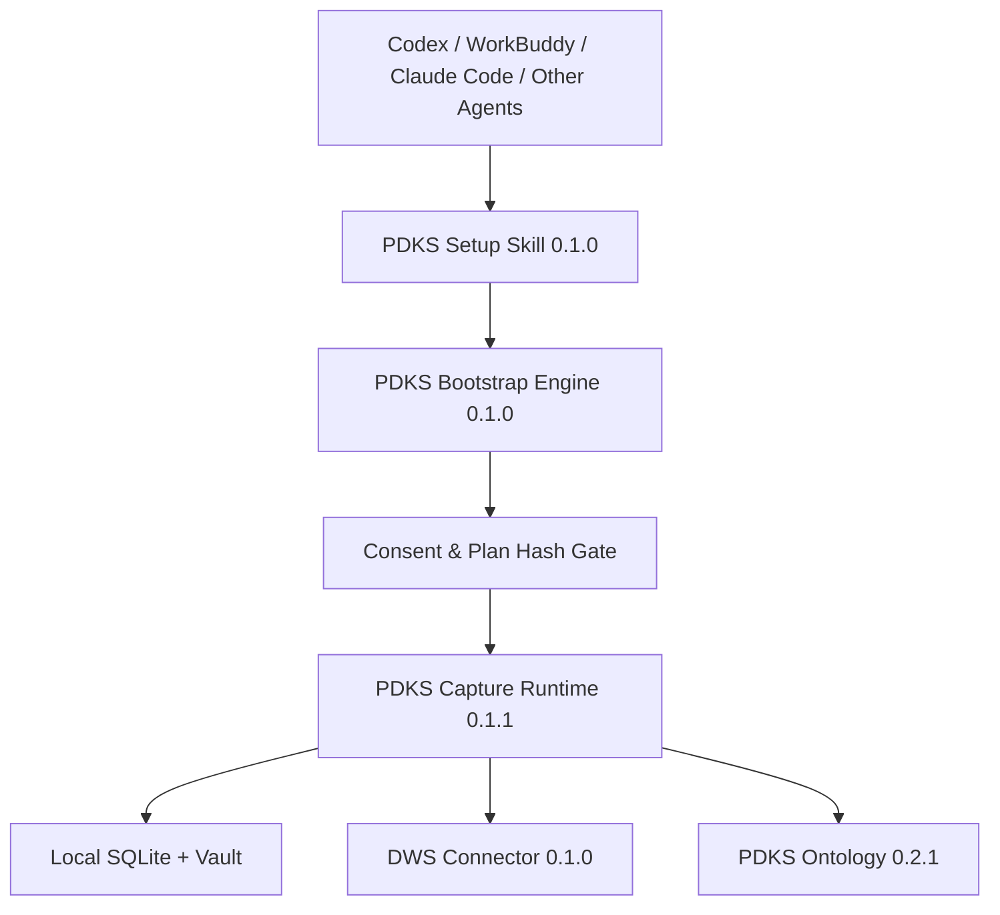

# PDKS 0.5.1.2：Agent 驱动安装架构与实施规范

> Bootstrap Engine 0.1.0 · Setup Skill 0.1.0 · Capture Runtime 0.1.1 · DWS Connector 0.1.0
>
> 阶段：过渡阶段 Skill 研发（Experimental / Preview）。本版本不等于生产级 Personal AI Life OS。

## 1. 产品决策

PDKS 安装从“用户手工安装软件”调整为“Agent 驱动、用户确认”的模式。Codex、WorkBuddy、Claude Code 和其他具备本地执行能力的 Agent 都可以扮演安装助手。

**核心原则：Agent 执行，用户决策；一次确认只授权一个明确范围。**

Agent 不是 PDKS 的宿主依赖。Agent 可以替用户安装和维护 PDKS，但个人数据始终保存在独立的 PDKS Runtime 中。

## 2. 分层架构



- Setup Skill：描述 Agent 的安装工作流、确认策略和安全边界。
- Bootstrap Engine：执行环境检测、计划生成、用户级安装、初始化和健康检查。
- Agent Adapter：适配不同 Agent 的本地执行与确认能力；不假设所有 Agent 都有相同权限。
- Capture Runtime：安装后的个人数据运行时。
- DWS Connector：钉钉来源适配器；连接和采集授权另行确认。

## 3. 用户体验目标

用户只需要告诉 Agent：“帮我安装 PDKS”。Agent 负责：

1. 找到完整 PDKS 工程包。
2. 检测系统、Python、磁盘、已有安装和 DWS。
3. 生成安装计划并展示安装路径、依赖、网络访问和安全限制。
4. 等待用户确认确切计划。
5. 安装、初始化并验证。
6. 汇报真实结果和仍需用户授权的步骤。

**用户不需要手动创建数据库、配置 Ontology、填写 JSON 或理解 Runtime 内部结构。**

## 4. L0-L3 确认机制

| 级别 | 内容 | 确认要求 |
|---|---|---|
| L0 | 系统检测、版本检测、磁盘检测、安装计划 | 自动执行，只读 |
| L1 | 用户目录安装、虚拟环境、PyPI 依赖 | 展示精确计划，用户确认计划哈希 |
| L2 | DWS 安装、钉钉 OAuth、Agent Skill 目录变更、后台服务 | 每个权限范围单独确认 |
| L3 | 聊天订阅、历史导入、删除、云备份、跨设备同步 | 每项单独确认，说明数据范围、目的地和可逆性 |

低级别授权不自动包含高级别授权。批准 PDKS Runtime 安装不代表批准钉钉登录或读取聊天内容。

## 5. Bootstrap Engine 0.1.0

位置：`skills/pdks-setup/scripts/pdks_setup.py`

命令：

```bash
# 只读检查
python skills/pdks-setup/scripts/pdks_setup.py doctor

# 生成确定性安装计划
python skills/pdks-setup/scripts/pdks_setup.py plan

# 用户确认计划哈希和未加密存储限制后安装
python skills/pdks-setup/scripts/pdks_setup.py install \
  --approve-plan <EXACT_PLAN_SHA256> \
  --acknowledge-unencrypted-storage

# 安装后健康检查
python skills/pdks-setup/scripts/pdks_setup.py verify

# 只生成卸载预览，不删除数据
python skills/pdks-setup/scripts/pdks_setup.py uninstall-plan
```

### 5.1 计划哈希

安装计划包含平台、Python 版本、Bundle 路径、安装路径、DWS 是否已检测到、安装动作、网络依赖和数据行为。Engine 对规范化 JSON 计算 SHA-256。安装时重新计算并比较；若计划发生变化，原批准失效，必须重新向用户展示并确认。

计划哈希不是数字签名，也不能替代可信软件来源校验；它的作用是绑定用户批准的计划内容，防止 Agent 在用户批准后静默改变安装参数。

### 5.2 安装范围

- 默认安装到当前用户目录，不需要管理员权限。
- 拒绝写入当前用户 Home 目录之外。
- 拒绝覆盖非空且没有 PDKS 安装标记的目录。
- Runtime 源码从当前完整 Bundle 复制，不执行远程 PDKS 安装脚本。
- 在隔离 Python venv 中安装 `jsonschema>=4.18,<5`，只接受二进制 wheel。
- 自动创建 SQLite、Vault、默认 Owner 和 `pdks-runtime` Launcher。
- 默认不启用数据采集、不登录 DWS、不注册后台服务、不导入历史数据。
- 外部依赖下载使用 PyPI；计划中明确展示网络访问。

### 5.3 当前安全限制

Capture Runtime 0.1.1 的 SQLite 与 Vault 尚未加密。Bootstrap Engine 通过用户目录、目录权限和文件权限降低同机其他用户访问风险，但权限不等于加密。因此安装流程强制用户确认该限制，并明确只适合合成数据或非敏感评估数据。**在加密与密钥管理完成前，不应采集真实企业聊天、审批、会议纪要或其他敏感个人数据。**

## 6. DWS 安装与授权边界

DWS 是独立的官方钉钉 CLI，不应与 PDKS Runtime 混装成一个不可区分的组件。

- 若已安装：只检测版本，不登录、不读取业务数据。
- 若未安装：Agent 展示官方仓库、安装方式和可能影响（包括官方 DWS Skill 对 Agent 目录的写入），等待用户单独确认。
- DWS OAuth 登录由 DWS 官方流程完成；Agent 不读取或保存 Token。
- PDKS Consent、DWS 登录和企业管理员开通权限是三件不同的事。
- DWS Connector 真实事件投递仍需目标租户实测。

官方来源：<https://github.com/DingTalk-Real-AI/dingtalk-workspace-cli>。

## 7. Agent 兼容标准

Agent 具备以下能力才可声明“本地自动安装支持”：

1. 读取完整 Bundle 和 Setup Skill；
2. 在用户本机执行命令，而不是仅在云端沙箱执行；
3. 将安装计划和警告展示给用户；
4. 等待明确批准并传递精确计划哈希；
5. 返回实际安装和健康检查结果。

Codex、WorkBuddy、Claude Code 等具体宿主的本地执行权限、技能导入方式和审批机制可能不同。PDKS 不猜测宿主私有目录或权限；先检测，再按官方能力适配。无本地执行权限时退化为指导模式，不得宣称已安装。

## 8. 测试要求

新增 Setup Engine 测试覆盖：
- 计划哈希确定性；
- 安装路径限制；
- Bundle 缺失拦截；
- 非空目录保护；
- 未批准计划哈希拦截；
- 未确认未加密存储风险拦截；
- 无 Shell 拼接执行；
- 卸载仅提供非破坏性预览。

DWS 预检修复还需验证：
- 订阅前先检查 PDKS Consent；
- DWS 未登录、认证状态不确定、Token 无效、本地状态需修复或不可读时 fail-closed；
- Profile 不完全匹配或 Schema 不可读取时，不启动订阅。

## 9. 尚未交付的能力

- 原生签名 Windows MSI、macOS notarized PKG/DMG；
- 嵌入式 Python；当前需要 Python 3.10+；
- 自动安装 DWS 和完整 OAuth 授权向导；
- Codex / WorkBuddy 真实宿主环境逐一联调；
- 后台守护、开机自启、断线恢复；
- Runtime 加密、密钥管理和生产级数据保护；
- 历史分页回填、自动补漏；
- 破坏性卸载、版本升级和数据迁移。

## 10. 阶段结论

本版本交付了 Agent-neutral 的 Setup Skill、可执行 Bootstrap Engine、用户级安装计划与确认门禁，以及 DWS 预检 P0 修复。它可以在有 Python 3.10+ 的本地环境中安装实验性 Runtime；尚不是双击即装的商业安装器，也不能据此启用真实敏感数据采集。
