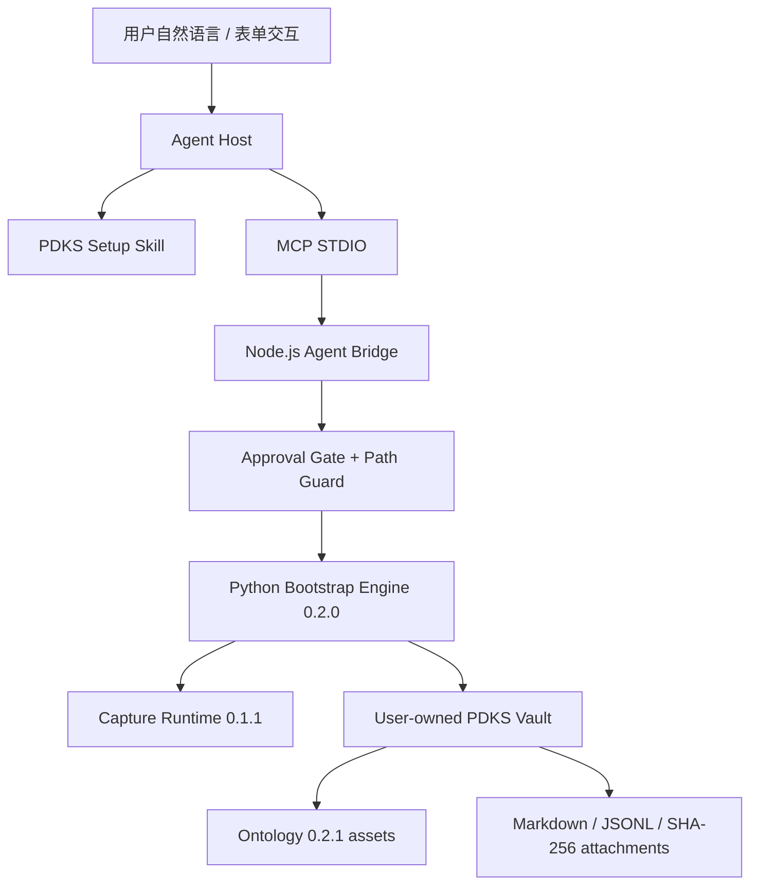

# PDKS 0.5.2.2 — Agent-native Bootstrap 与交互式初始化架构

> 版本：Agent Bridge 0.1.0 / Python Bootstrap Engine 0.2.0  
> 研发阶段：`transitional_skill_development`  
> 成熟度：Experimental / Preview  
> 基线：PDKS Standard 0.1.0、Record Schema 0.1.x、Ontology 0.2.1、Event Taxonomy 0.1.0、Personal Knowledge Skill 0.3.4 均不变。

## 1. 决策摘要

PDKS 初始化不应再以 CLI 为普通用户的主要入口。CLI 保留为开发者、自动化和故障排查接口；普通用户优先在具备本地 MCP 能力的 Agent 中，通过自然语言、MCP 工具和可选的交互式面板完成初始化。

本版本采用：

- **Node.js Agent Bridge**：跨平台本地入口，负责工具暴露、参数校验、路径安全和调用既有 Bootstrap Engine。
- **MCP**：Agent 与 PDKS 本地服务之间的标准工具协议。
- **MCP Apps**：在支持的宿主中提供路径选择、环境检查、计划审阅和确认面板。
- **Agent Skill**：教 Agent 如何安全地调用上述工具；不代替运行时和权限控制。
- **现有 Python Bootstrap Engine**：继续执行 Capture Runtime 安装，避免在本版本重写现有 Runtime。
- **File-first Vault**：安装后在用户可见目录初始化 Markdown / JSONL / 附件结构，并种入 Ontology 0.2.1 文件。

本版本不是原生 Node.js Runtime，也不是最终 PDKS 或 Personal Assistant OS。

## 2. 目标用户体验

用户在任一支持本地 MCP STDIO 的 Agent 中说：“帮我初始化 PDKS。”

预期流程：

1. Agent 调用 `pdks_doctor`，只读检查环境和路径。
2. Agent 调用 `pdks_bootstrap_plan`，生成绑定安装路径、Vault 路径和环境信息的确定性计划。
3. 若宿主支持 MCP Apps，Agent 打开 `pdks_setup_wizard`，展示表单式配置面板；不支持时，Agent 以普通对话逐项展示相同信息。
4. 用户查看安装目录、知识库目录、依赖下载、安装动作和未加密风险。
5. 用户输入 `CONFIRM INSTALL PDKS` 或点击面板确认，并勾选未加密风险知情项。
6. Agent 调用 `pdks_bootstrap_apply`，服务端重新计算计划哈希并验证确认信息。
7. Agent 调用 `pdks_verify`，报告实际验收结果。

默认不连接数据源、不登录钉钉、不订阅事件、不导入历史数据、不启用后台服务、不启用云同步。

## 3. 架构



职责边界：

| 层 | 职责 | 不负责 |
|---|---|---|
| Agent Skill | 交互步骤、用户说明、权限提醒、工具选择 | 直接写数据库、绕过确认 |
| MCP Server | 标准工具接口、输入校验、工具描述 | 自动获得用户授权 |
| MCP Apps | 路径表单、计划预览、确认 UI | 作为安全边界或凭据保险箱 |
| Node Bootstrap | 环境探测、路径约束、哈希确认、进程编排 | 重写全部 Capture Runtime |
| Python Bootstrap | 建 venv、安装 Runtime、初始化 SQLite 和 Vault | 自动采集或接入数据源 |
| Runtime / Vault | 采集数据治理、来源证据、文件资产 | 由 Skill 直接操作 |

## 4. MCP 工具契约

| 工具 | 读写 | 输入重点 | 约束 |
|---|---|---|---|
| `pdks_doctor` | 只读 | installRoot / vaultRoot | 不安装、不写数据 |
| `pdks_bootstrap_plan` | 只读 | installRoot / vaultRoot | 返回确定性 `plan_sha256` |
| `pdks_bootstrap_apply` | 写入 | plan hash、确认短语、风险确认 | 唯一安装写操作；服务端重算计划 |
| `pdks_verify` | 只读 | installRoot / vaultRoot | 报告实际检查 |
| `pdks_vault_status` | 只读 | vaultRoot | 只读 manifest 元数据，不读取笔记内容 |
| `pdks_agent_config_preview` | 只读 | host 类型 | 只输出配置片段，不修改 Agent 配置 |
| `pdks_setup_wizard` | 只读入口 | 可选路径 | MCP Apps UI；宿主不支持时用文本工具替代 |

未来可增加来源连接、迁移和权限管理工具，但必须各自建立独立授权与审计流程，不应把这些操作隐含在初始化工具中。

## 5. 交互模式

### 5.1 MCP Apps 面板

MCP Apps 采用 Tool + UI Resource 模式：工具通过 UI metadata 关联 `ui://pdks/setup-wizard.html`，宿主在支持该扩展时渲染沙箱化界面。面板提供：

- 安装路径和 Vault 路径输入；
- 环境检查与结果状态；
- 安装计划动作清单和网络依赖；
- 计划哈希展开查看；
- 未加密风险确认；
- 必须完整输入的确认短语；
- 安装结果和验证状态。

MCP Apps 是可选增强，不是协议基础能力。宿主不支持时，Agent 仍然可以用 `pdks_doctor`、`pdks_bootstrap_plan`、`pdks_bootstrap_apply` 完成流程。

### 5.2 MCP Elicitation 与对话式回退

当宿主声明 MCP Elicitation 能力、且 Agent 没有随工具调用提供确认参数时，服务端可通过标准 Elicitation 表单请求确认短语和未加密风险知情项。表单只收集非敏感确认，不收集密码或 Token。

如果宿主不支持 Elicitation，Agent 应展示同一份计划，并要求用户明确回复/输入确认短语。不能把“帮我安装”视为对未加密风险的知情同意。

### 5.3 CLI 回退

保留 `pdks-agent doctor|plan|apply|verify|config|mcp` 以及原有 `pdks-runtime` 命令。CLI 与 MCP 复用相同的 Python Bootstrap Engine，避免双重业务逻辑。

## 6. 安全和确认模型

### 6.1 只读与写操作

- 只读：doctor、plan、verify、Vault status、Agent config preview。
- 写操作：apply。
- apply 必须具备：当前计划 SHA-256、精确确认短语 `CONFIRM INSTALL PDKS`、`acknowledgeUnencryptedStorage=true`。
- 安装路径和 Vault 路径必须位于当前用户 Home 内。
- 非空且无 PDKS 标识的目录一律拒绝，不覆盖用户文件。
- 现有 PDKS Vault 的用户配置和本体文件不会被默认文件覆盖；仅补齐不存在的初始资产。
- 不请求管理员权限，不注册后台服务。

### 6.2 凭据

MCP 表单和普通对话不允许收集密码、OAuth Token、API Key 或支付凭据。未来连接第三方来源时，应使用来源方授权流程、URL Elicitation 或宿主自己的安全授权机制。

### 6.3 本地与云端

当前 Bridge 只提供本地 STDIO 入口。云端 Agent 不能凭空访问用户本机目录；必须存在经用户明确配置的本地执行桥。当前版本不实现远程 Relay、TLS 网关或云端文件上传。

### 6.4 当前存储风险

Capture Runtime 0.1.1 的 SQLite 和本地文件尚未提供静态加密。即使安装流程完成，也只适合合成或非敏感测试数据。不能因为使用 MCP 或 Node.js 就宣称数据已加密。

## 7. 安装后的目录与文件

安装时生成：

```text
PDKS-Vault/
├── README.md
├── PDKS-MANIFEST.json
├── 00-Inbox/ ... 95-Archive/
├── 90-Source-Records/
├── assets/sha256/
└── .pdks/
    ├── config/runtime.json
    ├── ontology/0.2.1/        # 从 Skill 包复制的版本化本体资产
    ├── schemas/
    ├── index/                # 可重建索引
    ├── audit/
    └── conflicts/
```

`.pdks/config/runtime.json` 标记当前 Standard、Schema、Ontology、Taxonomy 版本，并明确 `default_capture_enabled=false`、`cloud_sync_enabled=false` 和 `sensitive_data_allowed=false`。

运行时 SQLite 和 blob store 仍由现有 Capture Runtime 保存。Vault 是面向用户查看和迁移的 File-first 资产层；本版本没有完成所有采集时双写、完整操作状态重建和双向同步。

## 8. Node.js 技术选型

- Node.js 22.12+：满足当前 MCP Apps SDK 的 Node.js 运行要求。
- `@modelcontextprotocol/server` 2.x：官方 TypeScript/JavaScript Server SDK，提供 STDIO、Tools、Resources 和新协议兼容。
- `@modelcontextprotocol/ext-apps` 2.x：官方 MCP Apps 工具与 UI Resource 注册助手。
- `zod` 4.x：工具输入结构校验。
- Vite + vite-plugin-singlefile：将初始化面板构建为单 HTML 资源。

官方 SDK v2 支持 Node.js/Bun/Deno，并提供 MCP Server 与 Client 包；MCP Apps 通过 Tool + UI Resource 将界面嵌入支持的 Agent Host。参考：

- https://github.com/modelcontextprotocol/typescript-sdk
- https://ts.sdk.modelcontextprotocol.io/v2/
- https://github.com/modelcontextprotocol/ext-apps
- https://apps.extensions.modelcontextprotocol.io/api/

## 9. 当前已实现与未实现

| 能力 | 状态 |
|---|---|
| Node.js Agent Bridge 目录和 CLI | 已实现源码 |
| Node 环境与 Python 版本探测 | 已实现并通过本机测试 |
| 跨平台默认安装路径 | 已实现并通过 Node 单元测试 |
| Home 路径安全检查 | 已实现并通过 Node 单元测试 |
| 安装计划和哈希确认 | 复用 Python Bootstrap Engine，已通过测试 |
| MCP Tool Server | 已实现源码，依赖安装和真实协议联调待执行 |
| MCP Apps UI 源码 | 已实现，需 npm install + npm run build |
| Agent 配置片段输出 | 已实现，不自动修改宿主配置 |
| File-first Vault 初始化 | 已接入 Python Bootstrap，初始化函数可独立测试 |
| Ontology 0.2.1 文件种入 | 已实现，只补齐缺失文件 |
| 自动安装 Python | 未实现 |
| Node-native Capture Runtime | 未实现 |
| MCP Apps 多宿主实测 | 未执行 |
| ChatGPT / Claude / Cursor / Codex / WorkBuddy 端到端实测 | 未执行 |
| 数据加密、Keychain、远程 Relay | 未实现 |

## 10. 本轮验收方式

1. `node --check` 检查 Agent Bridge JavaScript 文件语法。
2. `node --test agent-native/tests/core.test.js` 验证跨平台路径、路径安全、确认门禁和 MCP 配置预览。
3. `python -m unittest discover -s tests -p test_pdks_setup_engine.py -v` 验证安装计划、路径拒绝、确认门禁、Vault 初始化和用户文件保护。
4. `node agent-native/bin/pdks-agent.js doctor` 检查实际环境。
5. `node agent-native/bin/pdks-agent.js plan` 检查实际计划。
6. 安装 npm 依赖后 `npm run build`，再以 MCP Inspector 或实际 Agent Host 测试 `tools/list`、`pdks_setup_wizard`、`pdks_bootstrap_plan` 和 apply 确认。
7. 使用临时目录完成一次真实安装和 `pdks_verify`，不得在用户现有目录上做未经授权的试装。

## 11. 下一阶段

PDKS 0.5.2.3 建议推进：

1. 将 Python Bootstrap Engine 的安装、路径和状态契约逐步移入 Node 核心；
2. 提供签名校验的托管 Python 运行时或迁移 Capture Runtime 到 Node；
3. 完成 MCP Apps 构建与 MCP Inspector 自动化测试；
4. 为 Claude Desktop、Cursor、Codex、WorkBuddy 建立实际版本兼容测试矩阵；
5. 增加 Agent 配置的 Plan / Apply 两阶段流程，但默认只输出配置片段；
6. 先实现本地加密、密钥管理和恢复，再开放敏感真实数据采集；
7. 在安全门禁通过后，逐步接入 DWS、日历、邮件、文件和其他工作/生活来源。

最终原则不变：File-first、Ontology-driven、Agent-native、Local-first；Agent 只是入口，用户拥有数据，权限与审计由 PDKS Runtime 强制执行。
