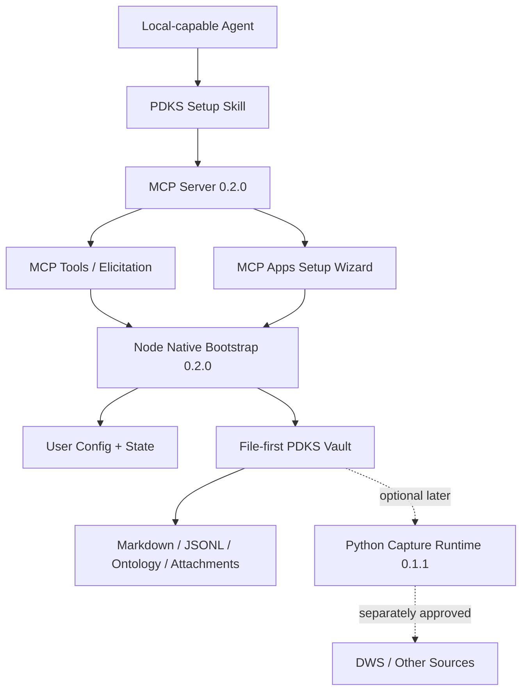

# PDKS 0.5.3 — Node 原生 Bootstrap 与跨 Agent 初始化实施规范

- 版本：PDKS 0.5.3 / Agent Bridge 0.2.0 / Native Bootstrap 0.2.0
- 阶段：`transitional_skill_development`
- 成熟度：Experimental Preview，不是生产版 Personal AI Life OS
- 兼容基线：PDKS Ontology 0.2.1、Record Schema 0.1.x、Event Taxonomy 0.1.0

## 1. 目标

让本地可执行的 Agent 通过自然语言、MCP 工具和可选 MCP Apps 面板完成 PDKS 的首次文件知识库初始化。普通用户不必理解 Python、SQLite、JSON-LD 或本体文件，也不必手动创建目录。

本版本将“建立用户拥有的 File-first Vault”与“安装自动采集 Runtime”拆成两个独立阶段。Node 原生初始化不要求 Python；可选 Capture Runtime 仍使用 Python 3.10+，需要单独安装和授权。

## 2. 产品原则

1. **Agent-native**：Agent 是用户的安装、配置与管理入口。
2. **Local-first**：初始化只在本机写入文件，不连接远端服务。
3. **File-first**：知识库由 Markdown、JSON/JSONL 与附件目录承载，Obsidian 可直接打开。
4. **Ontology-driven**：初始化时复制冻结的 PDKS Ontology 0.2.1 资产，不私自改写语义标准。
5. **User-controlled**：每个有副作用的操作都绑定具体计划、路径与用户确认。
6. **Progressive activation**：初始化 Vault、安装 Runtime、连接来源、开始采集是不同授权阶段。

## 3. 组件架构



## 4. 初始化工作流

| 阶段 | MCP 工具 | 行为 | 是否写入 |
|---|---|---|---:|
| 检查 | `pdks_native_doctor` | Node 版本、路径安全、目标目录、Ontology 资产 | 否 |
| 计划 | `pdks_native_plan` | 生成确定性计划和 SHA-256 | 否 |
| 确认 | Elicitation / 对话 / MCP Apps | 确认精确计划与未加密风险 | 否 |
| 执行 | `pdks_native_apply` | 创建配置、Vault 目录、模板与 Ontology 文件 | 是 |
| 验收 | `pdks_native_verify` | 校验 Manifest、Ontology 哈希、目录结构 | 否 |

若宿主不支持 MCP Apps，纯 MCP 工具与自然语言确认仍必须可完成完整流程。UI 是增强体验，不是必需依赖。

## 5. 默认目录

应用配置目录按操作系统使用当前用户范围：

- Windows：`%LOCALAPPDATA%/PDKS/0.5.3`
- macOS：`~/Library/Application Support/PDKS/0.5.3`
- Linux：`$XDG_DATA_HOME/pdks/0.5.3`，缺省为 `~/.local/share/pdks/0.5.3`

知识库默认位置：`~/PDKS-Vault`。

Vault 结构：

```text
PDKS-Vault/
├── PDKS-MANIFEST.json
├── README.md
├── 00-System/
│   ├── PROFILE.md
│   ├── DATA-SOURCES.md
│   ├── Templates/
│   └── Ontology/0.2.1/
├── 00-Inbox/
├── 10-Events/
├── 20-Knowledge/
├── 30-Entities/
├── 40-Tasks/
├── 50-Projects/
├── 60-Reflections/
├── 70-Archive/
├── 90-Source-Records/
│   ├── sources/
│   ├── evidence/
│   └── attachments/
└── .pdks/index/
```

## 6. 安全与确认契约

`pdks_native_apply` 必须同时满足：

- `approvedPlanSha256` 与当前重新生成的计划哈希完全一致；
- 用户明确输入 `CONFIRM INITIALIZE PDKS`，或在宿主提供的确认界面中执行等价确认；
- 用户明确确认本地文件未提供静态加密；
- 目标路径位于当前用户 home 下；
- 应用目录与 Vault 不相同、不嵌套；
- 目标目录为空或已由 PDKS 管理；非空、非 PDKS 目录直接拒绝。

以下操作绝不由首次初始化隐式触发：

- 安装 Python Capture Runtime；
- 登录钉钉或执行 DWS OAuth；
- 连接邮件、日历、文档、录音等数据源；
- 历史数据导入；
- 开启后台常驻采集；
- 云同步或备份；
- 修改 Agent 配置文件；
- 删除或覆盖用户文件。

## 7. 幂等与冲突

- 已存在且内容一致的系统资产保持不变。
- 用户可编辑的 Markdown 文件在再次初始化时保留，不自动覆盖。
- Ontology 受 SHA-256 Manifest 保护；若检测到被修改，不自动覆盖。
- 非空、非 PDKS 目标目录拒绝初始化。
- 不提供自动删除式卸载；删除用户数据必须由用户自行执行并有单独备份流程。

## 8. 存储与本体

初始化复制 `skills/pdks-personal-knowledge/assets/ontology/0.2.1/` 的正式资产。Vault 通过 Markdown + YAML Frontmatter、JSON/JSONL、附件与稳定 PDKS ID 保持跨工具可读。SQLite 仍属于可选 Capture Runtime 的运行态存储；File Store Adapter 0.1.0 目前是从 Runtime 到文件 Vault 的单向投影，不等于双向同步或完整运行态重建。

## 9. 依赖与安装边界

- Vault 初始化：Node.js 22.12+，使用 Node 内置模块，不要求 Python。
- MCP Server / MCP Apps：需安装 `agent-native/package.json` 中的 npm 依赖；构建 UI 需 Vite。
- Capture Runtime：Python 3.10+ 与相应依赖，另行审批。
- DWS：由用户使用钉钉官方 DWS CLI 安装和授权；PDKS 不收集或保存用户凭据。

首次接入存在“先安装 MCP Server 才能调用 MCP 工具”的引导问题。因此首次安装由本地可执行 Agent（例如 Codex/WorkBuddy 等具备本机执行能力的宿主）在用户确认后运行安装脚本；云端 Agent 若没有本地桥接，不能直接操作本机文件。

## 10. 已实现与未实现

### 本版本实现

- Node 原生 `doctor / plan / apply / verify` 核心；
- 确定性计划哈希与双重确认；
- 用户路径与符号链接安全检查；
- Vault 目录、Markdown 模板与 Ontology 0.2.1 复制；
- Manifest SHA-256 校验；
- 重复初始化保留用户编辑的 Markdown；
- MCP 工具与 UI 已接入 Node 原生流程（代码级实现）。

### 尚未完成

- npm registry 安装与构建流水线在当前离线环境中未能执行；
- MCP SDK 的端到端协议联调与 MCP Apps 实际渲染验证；
- Claude、Cursor、Codex、WorkBuddy 等真实宿主的逐一验收；
- 自动写入 Agent 配置、原生安装包签名与自动更新；
- Runtime Node 原生化；当前采集 Runtime 仍为 Python；
- Vault 静态加密、OS Keychain、远程同步与多设备冲突合并；
- 真实 DWS 租户采集验证。

## 11. 验收标准

1. Node 22.12+ 下 `npm test` 全部通过。
2. Native doctor 不依赖 Python。
3. 同一未变更环境生成相同计划哈希。
4. 未确认、确认短语错误、计划哈希过期均不写文件。
5. apply 后 Vault 可直接作为普通 Markdown 文件夹打开。
6. Ontology 0.2.1 文件被复制并纳入 Manifest。
7. 重复初始化不覆盖用户编辑的 Markdown。
8. Ontology 被修改后 verify 报告 degraded。
9. 初始化默认不连接来源、不采集、不联网、不启用云同步。
10. 无 MCP Apps 的宿主仍能通过文本工具完成初始化。

---

**定位声明：PDKS 0.5.3 是过渡阶段的 Agent-native Bootstrap 工程版，不是正式生产级个人数智底座，也不代表 Personal AI Life OS 已研发完成。**
