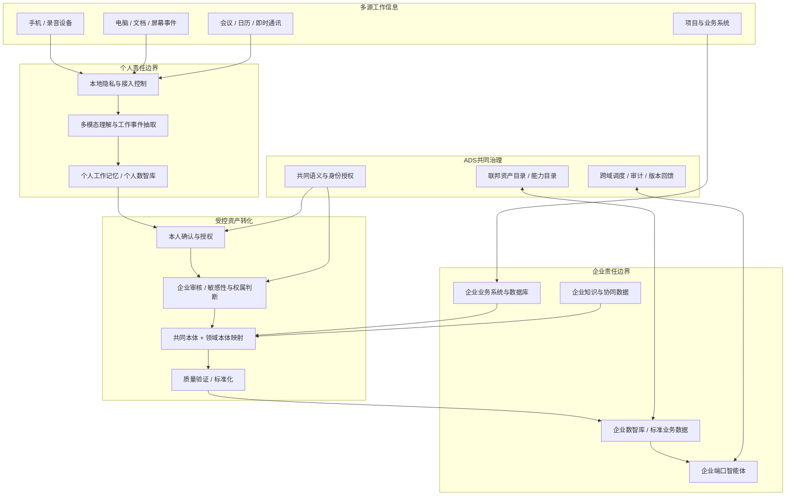

# 基于多源工作感知的个人与企业数智资产生成及协同机制研究

> 从个人工作上下文感知出发，研究个人数智资产如何在授权、语义映射和验证机制下进入企业业务体系，并最终支撑企业端口智能体。

| 项目 | 内容 |
|---|---|
| 文档编号 | ADS-WORK-01 |
| 版本 | V0.1-Research |
| 日期 | 2026-11-19 |
| 文档状态 | 专题研究方案 / 架构讨论稿 |
| 研究归属 | ADS 数智底座与 AI Native 工作基础设施研究 |
| 关联基线 | ADS-12 V0.3、ADS-19 V0.4、AI Native 数智基础设施总体架构 V1.0-Review |
| 范围说明 | 研究目标、逻辑架构、数据治理、验证路径与阶段规划；不是工程规格、法律意见或生产部署方案 |

---

## 摘要：本研究要解决什么问题

企业正在建设知识库、业务系统和 AI 助理，但 AI 对真实工作过程的理解仍然存在明显缺口。钉钉、邮件、项目系统和业务软件记录了部分正式活动，却未必完整呈现工作中的上下文、临时讨论、隐性决策、经验判断、任务变化和跨系统协作过程。录音卡、手机、电脑和会议工具可以补充信息入口，但单一录音设备并不能自动形成可靠的个人记忆，更不能直接形成企业可用的标准业务数据。

本研究提出：**将 AI 工作感知建设为个人数智底座面向真实工作世界的多源数据入口和上下文理解能力；通过个人记忆、业务对象关联、授权与语义映射，将其中适合共享的内容转化为企业数智资产；再与企业既有业务系统数据融合，形成可验证、可治理、可被企业端口智能体使用的标准业务数据与能力资产。**

这不是“把员工录音上传到企业知识库”，也不是“把所有个人记忆汇总成企业底座”。它是一条有边界、有审核、有版本、有撤回能力的资产转化链路。

### 核心结论

1. **个人数智底座是个人工作感知和个人数智资产沉淀的主要承载位置。** 原始工作信号首先服务于个人理解、回顾、检索和行动，不应默认成为组织可读取的数据。
2. **企业数智底座是企业自身业务运行与协同的数智基础设施。** 它由企业建立和管理，既承载企业业务系统与数据库，也承载经领域本体映射形成的标准业务数据、企业协同数据、证据和能力资产。
3. **个人工作信息只是企业数智资产的一个可选来源。** 只有经过授权、最小必要筛选、权属与敏感性判断、语义映射和质量验证，才可进入企业责任边界。
4. **业务领域中心数智底座负责共同语义、联邦目录、跨域协同与治理。** 它不应成为个人和企业原始数据的集中仓库。
5. **研究重点应从“做一张更方便的录音卡”升级为“建立工作上下文感知与资产化机制”。** 录音卡只是可能的采集终端之一，采集设备不等于底座能力。
6. **跨人复用不应从迁移个人记忆开始验证。** 应验证经抽象、验证和版本化的工作流程、标准、模板和能力资产，能否在同一业务场景的不同人员之间复用。

---

## 1. 研究背景与问题定义

### 1.1 工作信息为什么没有被充分理解

日常工作由正式系统活动和大量非正式、跨系统活动共同构成：

- 正式活动：项目任务、工单、审批、客户记录、合同、会议纪要、邮件、业务系统操作。
- 非正式活动：临时讨论、口头交代、现场观察、经验判断、问题排查、跨部门协调、任务优先级变化。
- 隐性上下文：某项决定为什么产生、谁提出了约束、哪个风险尚未解决、某个方案为何被放弃、任务实际卡在哪里。

企业现有系统通常更擅长记录“已经结构化的业务结果”，对“结果如何形成”以及“工作上下文如何变化”的覆盖可能不足。即时通讯和会议记录能够补充一部分过程，但它们往往分散在不同应用、不同设备和不同人的记录中。

因此，研究问题不是简单增加一个录音入口，而是回答：

1. 如何在不制造持续监控和信息过载的前提下，可靠地感知与个人工作相关的信息？
2. 如何把原始信息转化为可校正、可追溯的工作事件、任务、决策和知识？
3. 如何把工作事件关联到企业真实业务对象，而不是只生成孤立的摘要？
4. 如何区分个人记忆、企业业务信息、第三方信息和可共享的组织经验？
5. 如何让经过验证的企业数智资产真正被业务智能体消费，并形成结果回流？

### 1.2 当前采集工具暴露出的产品问题

目前讨论中的录音卡等设备，至少需要验证以下问题：

- 生态割裂：录音、转写、摘要与钉钉、项目系统、知识库和 ADS 之间缺少完整连接。
- 使用摩擦：需要随身携带、充电、手动开启，容易忘记或漏录。
- 采集单一：音频不能完整表达屏幕操作、文档变化、业务状态和现场对象。
- 信息质量：转写错误、说话人识别错误、上下文缺失和重复内容会影响后续记忆。
- 成本与运维：设备采购、耗材、账号、模型调用、数据存储和维护成本需要整体评估。
- 治理边界：录音可能包含个人隐私、第三方信息、商业秘密和未经授权的内容。

这些问题说明，不能先把“自研录音卡”当作唯一答案。应先确定工作感知系统需要产生什么样的数据和服务，再决定哪些采集能力适合由手机、电脑、会议软件、现有录音设备或自研硬件承担。

### 1.3 研究目标

建立一套可渐进落地的工作感知与资产化机制，使 AI 能够：

- 在个人授权和可控条件下理解个人正在参与的工作；
- 持续形成有来源、有时间、有对象、有状态的个人工作记忆；
- 识别项目、客户、产品、任务、会议、决策、问题和行动项等业务对象；
- 将适合组织沉淀的内容提交到企业侧审核、映射和标准化；
- 让企业端口智能体使用经验证的标准业务数据与能力资产；
- 将执行结果、反馈和新证据回写到相应责任底座。

---

## 2. ADS 三级数智底座：本研究必须遵守的架构基线

本研究以 ADS-12、ADS-19 和《AI Native 数智基础设施总体架构 V1.0-Review》为架构约束。工作感知方案只能补充数据入口、语义理解和资产生成能力，不能改变三级底座既有的责任边界。

### 2.1 三级底座的分工

| 层级 | 核心定位 | 主要承载 | 主要职责 | 数据与权责边界 |
|---|---|---|---|---|
| 个人数智底座 | 个人数据与数智资产的自主沉淀和驱动基础 | 个人知识库、个人数据库、经本体映射生成的标准数据/数智、个人证据与资源记录 | 支撑个人 AI 助理执行、记忆、成长；形成个人数智资产 | 个人原始数据默认留在个人控制范围；对外共享需明确授权 |
| 企业数智底座 | 企业业务运行与业务协同的数智基础设施 | 企业业务系统、业务数据库、企业知识库、企业数据库、标准业务数据、协同数据、企业证据与能力资产 | 将企业业务数据经领域本体映射形成标准业务数据，驱动企业端口智能体 | 企业/领域责任方按制度、合同和授权管理企业数据与资源 |
| 业务领域中心数智底座 | ADS 配套的共同语义、跨域发现、协同和治理基础设施 | ADS 共同本体、共同语义标准、联邦资产目录、能力目录、跨域任务与审计信息 | 支撑跨系统、跨领域协同，提供共同语义、调度治理和版本化回馈 | 不默认持有个人或企业原始数据；按任务处理授权的最小必要信息 |

> **术语说明：** ADS-12/ADS-19 的早期材料使用“智能生态系统中心数智底座”表述；《AI Native 数智基础设施总体架构 V1.0-Review》采用“业务领域中心数智底座”。本文暂按 V1.0-Review 使用“业务领域中心数智底座”，将两个术语的正式映射和冻结列为架构评审事项，不擅自宣称术语变更已完成审批。

### 2.2 企业数智底座的准确定位

企业数智底座不是：

- 企业知识库的同义词；
- 员工个人知识库或个人录音的集中汇总；
- 所有 SaaS 原始数据复制到 ADS 的数据湖；
- 一个只负责存储文档、向量和聊天记录的 AI 知识问答系统；
- 业务领域中心数智底座的下级数据分区。

企业数智底座应当是企业自己建立和管理的业务数智基础设施，至少融合四类来源：

1. **既有业务系统数据**：ERP、CRM、项目管理、PLM、工单、财务、人力、供应链等系统中的业务数据。
2. **企业知识资产**：制度、流程、标准、方案、技术文档、项目复盘、产品资料和专业知识。
3. **企业协同数据**：经授权形成的会议决策、任务协作、问题处理、跨部门协同和业务过程记录。
4. **经验证的企业数智资产**：领域本体映射后的标准业务数据、证据资产、能力与经验资产。

其中，工作感知产生的内容可以补充第三类，并在满足条件后转化为第四类；它不能取代第一类和第二类。

### 2.3 三级关系不是简单的逐级数据汇总

三级底座是治理和资源组织层级，不是三个本体层级，也不是简单的“个人上传—企业汇总—中心集中存储”。

- 自下而上：个人或企业侧经标准化、授权的数据与协同信息，在任务所需范围内汇流。
- 自上而下：经过验证、版本化、适用范围明确的共同标准、能力和协作经验回馈到下级。
- 横向协同：同级企业、领域或智能体之间通过受控目录、语义契约和授权交换协作。
- 内部闭环：证据主要服务人类判断、审批和验收；标准数据主要服务智能体运行，两者来源可以相关，但用途和治理要求不同。

### 2.4 ADS 在这条链路中的角色

ADS 不是工作录音应用，也不应直接成为所有员工工作数据的采集仓库。ADS 在这条链路中主要提供：

- 共同语义和共同本体治理；
- 身份、代表关系和授权协调；
- 跨域任务契约、能力注册与发现；
- 跨系统、跨领域任务协同和调度治理；
- 执行审计、证据关联、评价与经验回写；
- 共同标准、协作模板和能力版本的管理。

工作感知产品负责在个人和企业责任边界内产生、理解和整理工作上下文；ADS 负责在授权范围内帮助这些资产与企业业务和跨域协同建立联系。

---

## 3. 核心研究定位：从录音工具升级为工作上下文基础设施

### 3.1 建议的研究名称

**基于多源工作感知的个人与企业数智资产生成及协同机制研究**

副标题：从个人工作上下文感知到企业标准业务数据与端口智能体驱动。

### 3.2 核心定义

工作感知不是对人的持续监控，而是在明确的用户控制、组织规则和数据授权下，对与工作相关的多源信息进行采集、理解、关联、记忆和资产化。

工作感知系统的核心产物不是音频文件或会议摘要，而是：

- 工作事件：何时发生了什么；
- 任务与行动项：谁需要在什么条件下完成什么；
- 决策与依据：做出了什么决定、原因和约束是什么；
- 业务对象关联：涉及哪个项目、客户、产品、订单、问题或流程；
- 证据与来源：信息来自何处、由谁确认、是否可核验；
- 个人知识与经验：对个人后续工作有帮助的上下文；
- 可复用能力候选：经抽象、验证后可跨人员或团队复用的方法、模板和流程。

### 3.3 研究假设

| 编号 | 研究假设 | 验证方式 |
|---|---|---|
| H1 | 多源工作感知比单一录音更能还原工作上下文 | 对照音频、会议、日历、文档、任务系统等来源，比较事件完整性 |
| H2 | 以“工作事件”为中间对象，比直接生成长篇摘要更适合持续记忆与检索 | 比较事件模型与纯摘要在检索、追溯和更新方面的表现 |
| H3 | 将事件关联到企业业务对象，能显著提升企业侧可用性 | 检查项目、客户、产品、任务等对象关联准确率 |
| H4 | 通过个人授权和企业审核的资产转化机制，可以在保护个人边界的同时形成组织资产 | 评估授权清晰度、审核接受率、撤回处理和资产质量 |
| H5 | 经验证的工作流程和能力资产可以跨人员复用，而个人原始记忆不需要跨人复制 | 在同类任务、不同执行者之间进行受控复用测试 |
| H6 | 企业工作上下文与既有业务系统融合后，能比独立知识库更有效地驱动企业 Agent | 以任务完成质量、耗时、错误率和人工介入量进行对照 |

这些是假设而非已证实结论。每项假设都应通过试点数据验证，不以演示效果代替长期有效性证据。

---

## 4. 从原始工作信息到数智资产：分层模型

建议采用“原始信号—工作事件—个人记忆—业务语义—企业资产—智能体运行”的转化模型。

### 4.1 六类对象

| 对象 | 说明 | 典型示例 | 是否可直接驱动企业 Agent |
|---|---|---|---|
| 原始信号 | 采集到的原始音频、文本、图片、文件或设备事件 | 会议录音、语音片段、文档版本、屏幕操作事件 | 否，通常仅作为加工原料 |
| 工作事件 | 从信号中识别出的、带时间和上下文的事件 | 项目讨论、客户反馈、问题发现、任务变更 | 通常不能直接驱动，需确认和映射 |
| 个人记忆 | 面向个人理解、检索和后续行动的上下文 | 个人待办、沟通背景、经验笔记、决策回顾 | 默认不直接共享 |
| 业务语义对象 | 与企业业务对象建立关系后的结构化内容 | 项目状态变化、客户需求、产品缺陷、风险事项 | 经质量和权限检查后可进入标准化 |
| 标准数据/证据资产 | 经本体映射、标准化、验证或核验的资产 | 标准业务状态、经确认的决策记录、验收证据 | 标准数据可在授权范围内驱动；证据主要服务人类判断 |
| 能力与经验资产 | 从反复实践中抽象并验证的方法、模板和流程 | 项目启动清单、问题诊断流程、会议决策模板 | 经批准、适配和授权后可复用 |

### 4.2 为什么要以“工作事件”为关键中间层

如果系统只保存录音和摘要，后续很难回答：

- 某个决定是在什么时间、哪次会议、基于哪些事实形成的？
- 某项任务为什么被新增、延期或取消？
- 某个风险与哪个项目、客户或产品相关？
- 哪条信息是 AI 推断的，哪条信息已经被当事人确认？
- 同一事项在多个渠道出现时，哪些是重复记录，哪些是状态变化？

因此，每条工作事件至少应包含：

| 字段 | 说明 |
|---|---|
| event_id | 唯一事件标识 |
| event_type | 会议、决策、任务、问题、客户反馈、状态变化等 |
| occurred_at / captured_at | 事件发生时间与采集时间 |
| actor_refs | 相关人员或角色引用 |
| business_object_refs | 项目、客户、产品、订单、工单等业务对象引用 |
| summary | 简短事件描述 |
| source_refs | 原始信号或来源引用 |
| evidence_refs | 支持事件判断的证据引用 |
| confidence | AI 识别置信度或质量状态 |
| confirmation_status | 待确认、已确认、已驳回、已修订 |
| sensitivity | 敏感级别或组织分类 |
| owner_tier | 个人、企业或领域责任底座 |
| authorization_ref | 对外共享时关联授权记录 |
| ontology_version | 使用的共同本体和领域本体版本 |
| lifecycle_status | 候选、有效、冻结、归档或撤回 |

AI 推断、用户确认和业务系统事实必须区分保存，不能把模型生成的推测直接写成已验证事实。

---

## 5. 参考逻辑架构

### 5.1 七个逻辑层

1. **多源采集层**：手机、电脑、会议软件、录音设备、日历、即时通讯、文档和业务系统连接器。
2. **本地隐私与接入层**：采集状态、用户控制、来源识别、敏感内容过滤、脱敏、缓存和上传策略。
3. **多模态理解层**：语音转写、说话人区分、OCR、文档解析、事件识别、实体抽取、去重和置信度评估。
4. **个人工作记忆层**：按时间、人物、任务、项目和主题组织工作事件，支持检索、回顾、纠错和行动提醒。
5. **语义映射与资产化层**：通过 ADS 共同本体和业务领域本体，将事件映射到业务对象、属性、关系、状态和标准。
6. **企业数智底座层**：融合企业业务系统、企业知识库、企业协同数据和经验证的标准业务数据，支撑企业端口智能体。
7. **ADS 协同治理层**：提供共同语义、身份授权、联邦目录、能力发现、跨域调度、审计和版本化回馈。

### 5.2 架构示意

图示表达的是逻辑责任边界，不代表所有模块必须独立部署，也不预设中心化存储。原始数据可以留在本地或企业环境，跨层协同可采用受控引用、受控查询或经批准的数据交换。

### 5.3 数据流转的基本步骤

1. **采集**：用户主动开启或在明确配置的工作场景中授权采集。
2. **理解**：从多源信息中识别事件、人物、时间、任务和候选业务对象。
3. **个人沉淀**：先形成个人可查看、可编辑、可删除或可归档的工作记忆。
4. **候选提取**：识别可能具有企业价值的任务、决策、问题、流程和经验。
5. **权属与授权判断**：判断内容属于个人、企业、第三方或混合信息；明确接收方、目的、字段范围、期限和再共享条件。
6. **企业审核**：由企业指定责任人判断是否接收、如何脱敏、是否需要补充证据。
7. **语义映射**：关联企业项目、客户、产品、流程和业务状态，应用共同本体与领域本体。
8. **标准化与验证**：通过规则校验、业务系统交叉验证和人工确认，形成标准业务数据或证据资产。
9. **智能体使用**：在权限、版本和适用范围内供企业端口智能体使用。
10. **结果回流**：智能体执行结果和新证据回到对应责任底座，供复盘和能力改进。

---

## 6. 个人资产如何转化为企业资产

### 6.1 不采用“自动上传”，采用“候选—授权—审核—映射—验证—发布”

| 阶段 | 责任主体 | 关键动作 | 结果状态 |
|---|---|---|---|
| 个人形成 | 个人 / 个人助理 | 生成工作事件、个人记忆和来源引用 | 个人资产 |
| 候选识别 | 个人助理 | 识别可能具有企业业务价值的内容 | 企业资产候选 |
| 授权提交 | 个人或合法授权代表 | 指定接收方、目的、对象范围、动作和期限 | 待企业接收 |
| 企业审核 | 企业数据责任人 / 业务负责人 | 判断权属、敏感级别、必要性、脱敏要求和可用范围 | 接收、退回或拒绝 |
| 语义映射 | 领域数据 / 本体责任方 | 关联业务对象、领域概念、标准和状态 | 已映射 |
| 质量验证 | 业务责任人 / 系统规则 | 核对来源、事实、冲突、完整性和版本 | 已验证或待修订 |
| 发布使用 | 企业数智底座管理员 / Agent 治理责任人 | 发布到企业数智库，配置可用 Agent 和场景 | 有效企业资产 |
| 生命周期管理 | 责任主体 | 版本更新、冻结、撤回、归档和审计 | 持续治理 |

### 6.2 资产转化的五种结果

不是所有个人工作信息都应该进入企业：

- **仅个人保留**：个人工作习惯、私人反思、个人计划或与企业无关的信息。
- **个人保留、企业可引用**：个人拥有的经验或笔记，企业只获得受控引用或经授权的摘要。
- **转为企业协同记录**：会议决策、项目任务、风险事项等，经业务责任人确认后进入企业记录。
- **转为企业标准业务数据**：经领域本体映射、业务规则校验和责任人验证后，可在授权范围内驱动 Agent。
- **转为能力与经验资产**：从多次实践中抽象出的流程、模板、检查表或方法，经验证、批准和版本管理后复用。

### 6.3 授权最小字段

至少明确：

- 授权主体与被授权主体；
- 代表关系（如由个人助理代为提交）；
- 接收方与具体用途；
- 数据字段、对象或内容范围；
- 允许动作（查看、引用、加工、存储、运行、再共享等）；
- 授权期限与撤回方式；
- 是否允许生成派生数据；
- 是否允许跨项目、跨部门或跨领域复用；
- 保存、删除和审计规则。

授权撤回后，应阻断后续读取与汇流，并按事先约定处理缓存、副本和派生数据；必要审计记录应按组织制度和适用规则保留。技术记录不替代法律、合同对权利的认定。

---

## 7. 关键创新方向

### 创新一：从“录音记录”转向“工作事件账本”

不以录音时长和摘要数量作为主要价值指标，而是形成可追溯的事件序列：任务提出、状态变化、决策形成、责任分配、风险暴露、结果验收。事件可以跨越会议、文档、聊天和业务系统，形成工作过程的连续上下文。

**创新价值：** AI 不只是“听过什么”，而是理解某项工作如何发生、如何变化以及当前处于什么状态。

### 创新二：个人工作记忆与企业业务对象的语义连接

把个人记忆中的“刚才讨论的那个客户问题”，关联到企业 CRM 客户、项目、工单、产品或订单，而不是停留在一段自然语言摘要。

**创新价值：** 从个人可检索的信息，转化为企业业务可识别、可追踪和可执行的上下文。

### 创新三：个人资产到企业资产的受控晋升机制

把“共享”从一次性文件上传升级为完整的资产生命周期：候选、授权、审核、映射、验证、发布、更新、撤回和审计。

**创新价值：** 让个人自主与企业知识沉淀不再是二选一，避免把个人数智底座变成员工监控系统。

### 创新四：证据与标准数据双轨分流

会议录音、截图、邮件和核验记录属于来源或证据；经映射和验证的标准业务数据才进入 Agent 运行链路。二者可以互相引用，但不能把模型推断直接等同于事实。

**创新价值：** 提高企业 Agent 的可追溯性、可解释性和业务可靠性。

### 创新五：从个人经验中提炼可验证的工作能力

个人记忆不直接复制给其他人。系统识别重复出现的工作模式，形成候选流程、模板、规则和 Skill，再由业务负责人验证、版本化和批准。

**创新价值：** 复用的是经过验证的工作方法，而不是某个人的私人记忆或未经验证的做法。

### 创新六：企业工作过程的可观测性

在授权和最小必要原则下，将任务、决策、协同、等待、返工和结果连接起来，帮助企业识别流程断点、信息重复录入、责任不清和知识缺口。

**创新价值：** 企业数智底座不只回答“有什么知识”，还逐步理解“业务如何运行、哪里存在摩擦、哪些能力可以改善”。

### 创新七：本地优先的隐私计算与边缘理解

在个人设备或受控环境中优先完成采集控制、初步识别、敏感信息过滤和内容选择；只有必要且获授权的内容才进入企业侧。

**创新价值：** 降低不必要的数据流动和中心存储压力，同时提升个人对工作记忆的控制力。

---

## 8. 典型业务场景

### 场景 A：会议讨论到项目行动闭环

1. 会议工具或用户授权的设备提供音频、日历和会议上下文。
2. AI 识别讨论主题、决策、待办、负责人、期限和风险。
3. 个人先查看并纠正识别结果。
4. 经授权后，将项目相关事项提交企业侧。
5. 企业侧关联项目、任务和责任人，并由项目负责人确认。
6. 企业 Agent 在权限内更新任务或提醒责任人。
7. 执行结果和新证据回写项目记录。

验收重点：决策与行动项准确率、项目关联准确率、人工修订率、任务闭环时间。

### 场景 B：客户需求与产品问题沉淀

1. 从获授权的客户会议、邮件或现场记录中识别客户诉求。
2. 关联 CRM 客户、产品版本、工单和问题分类。
3. 区分客户原话、员工判断和 AI 推断。
4. 经业务人员确认后形成客户需求或产品问题记录。
5. 企业 Agent 检查是否存在重复问题、相关版本和待处理任务。

验收重点：客户对象匹配率、重复问题识别率、来源可追溯性和误关联率。

### 场景 C：隐性经验转化为组织能力

1. 在多次同类任务中发现重复的处理步骤和判断模式。
2. AI 生成流程或 Skill 候选，并标注来源和适用条件。
3. 由有经验的员工和流程负责人共同验证。
4. 通过小范围试用和结果对比后发布版本。
5. 其他人员在同类任务中调用，记录适配、失败和改进情况。

验收重点：新使用者完成任务的质量、时间、错误率和对专家求助次数，而不是“能否复述专家的个人记忆”。

### 场景 D：跨系统工作上下文补全

将日历、会议、钉钉、项目管理、文档、CRM/ERP 等信息在授权范围内关联，补足单一系统无法表达的上下文。例如任务系统显示“延期”，工作事件账本能够提供经确认的延期原因、依赖关系和下一步行动。

验收重点：上下文补全率、事实冲突率、数据重复率和跨系统关联准确率。

---

## 9. 设备与产品策略：先验证采集体系，再决定是否自研硬件

### 9.1 设备不是系统本身

建议把产品能力拆成两部分：

- **采集终端层**：手机、电脑、会议软件、现有录音卡、耳机或未来自研设备。
- **统一工作感知服务层**：采集接入、事件理解、个人记忆、语义关联、授权管理、企业连接和 Agent 服务。

这样可以避免把产品路线锁死在某一种硬件上。未来更换设备时，个人工作记忆和企业资产链路不需要重做。

### 9.2 采集方式比较维度

| 方式 | 优点 | 局限 / 风险 | 建议角色 |
|---|---|---|---|
| 手机 | 普及率高、生态能力丰富、可与日历和通讯连接 | 录音权限、续航、携带与交互限制 | 第一阶段优先验证 |
| 电脑端 | 能连接文档、任务和业务系统上下文 | 无法覆盖全部线下场景；需明确屏幕与应用采集边界 | 工作桌面场景主入口 |
| 会议软件 | 会议上下文相对完整，容易关联参会人和日历 | 只覆盖会议场景 | 正式会议入口 |
| 现有录音卡 | 免手持、部分场景操作简单 | 充电、忘带、忘开、数据孤岛和成本问题需实测 | 对照组 / 补充入口 |
| 自研录音设备 | 可按组织需求设计按键、指示、续航、加密和接入 | 硬件研发、认证、供应链、售后和使用习惯成本 | 通过需求验证后再立项 |

### 9.3 是否自研录音卡的决策门槛

只有在试点证明“免手持、低操作摩擦、稳定采集、可靠同步、组织级管理”是明显瓶颈，且现有手机、会议和第三方设备无法满足时，才进入自研硬件立项。

硬件评估应包括：续航、充电方式、佩戴舒适度、误触与漏录、录制指示、物理暂停、离线缓存、加密、数据导出、生态 API、设备管理、采购与全生命周期成本。

Auday 等现有产品可作为体验与能力对标样本，但应通过实际试用记录功能、数据导出、隐私控制、系统集成和成本，不预设其能力优劣。

---

## 10. 验证策略：解决跨人、跨岗位复用难题

### 10.1 不把“换一个人是否有效”作为第一阶段唯一标准

个人工作记忆高度依赖个人背景、关系和上下文，要求另一个人直接复用原始记忆，本身就不是合理的首要验收方式。

应区分三种对象：

1. **个人记忆**：服务原本人，不以跨人复用为目标。
2. **团队协同资产**：经确认的项目决策、状态、任务和共享背景，可在授权团队内使用。
3. **可复用能力资产**：从多个实践中抽象、验证和版本化的流程、模板、规则与 Skill，才是跨人员复用的主要对象。

### 10.2 四级验证阶梯

| 级别 | 验证对象 | 验证问题 | 通过证据 |
|---|---|---|---|
| L1 个人有效 | 同一个人 | AI 是否准确记住工作上下文、减少重复整理？ | 检索成功率、纠错率、节省时间 |
| L2 团队协同 | 同一项目团队 | 是否减少信息遗漏、重复沟通和任务断点？ | 任务闭环、决策追溯、团队确认 |
| L3 岗位复用 | 同一类任务、不同人员 | 经验证的流程或 Skill 是否帮助新执行者完成任务？ | 任务质量、耗时、错误率、专家介入量 |
| L4 跨项目复用 | 相似业务流程、不同项目 | 能力资产是否具备稳定适用范围和迁移条件？ | 多项目验证、适配成本、失败边界 |

跨岗位和跨项目验证应在 L1、L2 质量稳定后开展，不应把个人隐性知识直接作为通用规则。

### 10.3 建议的对照实验

- 选择一个边界明确、发生频率较高、可观察结果的工作流程。
- 设定基线组：按现有工具和流程完成任务。
- 设定辅助组：使用工作感知、事件整理和企业 Agent 辅助。
- 尽量保持任务难度、时间窗口和人员经验可比。
- 由业务负责人按统一标准盲评结果质量。
- 分别统计效率、质量、纠错、人工介入和治理事件。
- 对能力复用测试，使用同类任务的新执行者，而不是让新执行者读取专家的全部个人记忆。

### 10.4 核心指标

| 指标组 | 指标 | 说明 |
|---|---|---|
| 采集质量 | 相关工作事件覆盖率 | 在抽样核对的真实工作事件中，系统成功捕获并识别的比例 |
| 理解质量 | 事件抽取准确率 / 召回率 | 事件、人物、时间、任务和决策识别效果 |
| 关联质量 | 业务对象关联准确率 | 项目、客户、产品、工单等是否关联正确 |
| 记忆质量 | 检索成功率、事实冲突率、人工纠错率 | 个人能否找回正确上下文 |
| 资产质量 | 企业审核通过率、标准数据验证通过率 | 候选内容能否成为企业可用资产 |
| 业务价值 | 任务耗时、遗漏率、返工率、闭环时间 | 是否改善实际工作结果 |
| 复用能力 | 新执行者任务质量、适配成本、专家介入量 | 能力资产是否跨人有效 |
| 治理质量 | 未授权访问事件、撤回处理时效、敏感信息误流转率 | 必须设置严格的安全门槛 |
| 经济性 | 单人月综合成本、单任务成本、节省工时 | 同时核算硬件、模型、存储、运维与管理成本 |

指标定义、抽样方法、基线和目标值应在试点启动前由业务负责人和数据治理负责人共同确认。安全与授权类指标不能用效率收益抵消。

---

## 11. 分阶段实施路线

### 阶段 0：架构与治理准备（约 2—4 周，建议）

**目标：** 冻结最小试点范围和数据边界。

- 选择一个真实工作流程和明确的业务负责人。
- 梳理该流程涉及的系统、数据对象和参与角色。
- 确认个人工作感知的自愿参与、采集指示、暂停、撤回和保留规则。
- 明确哪些内容仅个人保留、哪些可提交企业审核。
- 建立事件模型、业务对象清单和评估指标。
- 形成数据处理、安全和合规评审记录。

**阶段门槛：** 数据责任、授权、采集范围和退出机制没有明确前，不开展真实人员数据采集试点。

### 阶段 1：个人工作记忆 MVP（约 4—6 周，建议）

**目标：** 验证多源输入能否形成有用的个人工作上下文。

- 优先接入手机、电脑或会议工具中的现有能力。
- 允许用户主动录音或导入已获授权的会议记录。
- 形成工作事件、任务、决策和来源引用。
- 提供个人纠错、检索、回顾和导出能力。
- 不默认向企业侧同步原始音频或个人完整记忆。

**阶段门槛：** 个人用户愿意持续使用；事件质量、检索效果和操作摩擦达到预设标准。

### 阶段 2：企业业务对象关联（约 4—8 周，建议）

**目标：** 验证工作事件能否关联真实业务对象。

- 接入一个企业业务系统或项目管理系统。
- 建立项目、任务、人员、客户或产品的对象映射。
- 支持用户提交候选企业资产。
- 由企业责任人审核并完成语义映射。
- 记录来源、授权、版本和验证状态。

**阶段门槛：** 业务对象关联准确、审核流程可执行、授权和撤回路径可验证。

### 阶段 3：企业 Agent 业务闭环（约 6—10 周，建议）

**目标：** 验证标准业务数据是否真正提升企业 Agent 的业务能力。

- 选择一个低风险、可回滚的任务场景。
- 让企业 Agent 查询经验证的企业标准数据。
- 对写入、通知、派单等动作设置权限与人工确认门槛。
- 记录执行结果、证据和异常。
- 将结果回写企业责任底座。

**阶段门槛：** 业务结果质量有对照证据，且权限、审计和回滚机制有效。

### 阶段 4：能力资产复用与规模化（阶段评审后）

**目标：** 验证流程、模板和 Skill 的跨人、跨团队复用。

- 从多个已完成任务中提取能力候选。
- 由领域或业务责任人验证并发布版本。
- 在新执行者和新项目中开展受控测试。
- 建立适用范围、依赖、质量指标和失效条件。
- 再评估硬件自研、企业部署和跨领域扩展。

以上周期是规划估算，不是承诺工期；应根据数据授权审批、系统接入难度和试点范围调整。

---

## 12. 风险与控制

| 风险 | 可能表现 | 控制措施 |
|---|---|---|
| 员工监控化 | 把工作感知用于持续监控个人行为或绩效画像 | 用户可控、目的限定、采集透明、禁止未授权用途；单独进行组织制度与合规审查 |
| 个人与企业边界混淆 | 个人记录被自动上传或默认转为企业资产 | 个人默认留存；企业晋升必须经过授权、审核和用途限定 |
| 第三方信息泄露 | 会议或录音包含客户、同事和外部人员信息 | 采集前提示、最小化采集、敏感过滤、权限隔离和保留策略 |
| AI 幻觉成为事实 | 模型推断被写入企业业务状态 | 推断与事实分层；来源引用；人工确认；业务系统交叉验证 |
| 语义误关联 | 事件关联到错误项目、客户或产品 | 置信度阈值、候选确认、业务对象校验和纠错机制 |
| 数据孤岛 | 新工具又形成独立知识库 | 统一事件模型、连接器、标准导出和开放接口规划 |
| 设备依赖 | 系统价值绑定某一录音硬件 | 设备无关的采集服务层；多终端接入 |
| 过早微服务化 | 试点阶段架构复杂度过高 | 先冻结逻辑边界，按成熟业务能力渐进拆分 |
| 能力复用失败 | 把个人经验误当作通用流程 | 版本化、适用范围、独立验证、灰度试用和回滚 |
| 数据权属争议 | 技术记录被误认为法律权属结论 | 技术责任元数据与法律/合同权利分开处理 |

---

## 13. 需要在后续评审中确认的决策

| 编号 | 决策问题 | 建议原则 | 需要谁参与 |
|---|---|---|---|
| D-01 | “智能生态系统中心数智底座”与“业务领域中心数智底座”的正式术语关系 | 以总体架构 V1.0-Review 为当前研究用语，正式映射需评审冻结 | ADS 架构负责人 |
| D-02 | 工作感知的采集范围与用户控制方式 | 自愿、透明、可暂停、可撤回、用途限定 | 业务、员工代表、安全与合规 |
| D-03 | 个人工作记忆是否默认留在个人底座 | 默认个人控制；企业共享走单独授权流程 | 个人产品与数据治理负责人 |
| D-04 | 企业资产候选由谁审核 | 业务对象责任人和企业数据责任人共同确认 | 企业业务负责人 |
| D-05 | 工作事件与业务对象采用哪些共同字段 | 共同本体提供通用锚点，领域本体定义专业对象 | ADS 与领域本体负责人 |
| D-06 | 音频、转写和派生数据的保存策略 | 分类型、分用途、最小必要、可追溯 | 安全与数据治理负责人 |
| D-07 | 企业底座部署方式 | 自建、私有化、托管或混合承载由资源责任方评估 | 企业 IT 与业务负责人 |
| D-08 | 是否自研录音硬件 | 先完成多终端对照试点，再根据瓶颈决策 | 产品、硬件、采购与 IT |
| D-09 | 企业 Agent 可以读取或写入哪些资产 | 基于用途、对象、角色、版本和风险等级授权 | Agent 治理与业务负责人 |
| D-10 | 能力资产发布和跨人复用的验收规则 | 领域责任人批准，明确版本、适用范围、兼容性和回滚 | 领域负责人 |

---

## 14. 试点验收清单

### 架构与边界

- [ ] 个人、企业、业务领域中心三级数智底座的责任边界清晰。
- [ ] 工作感知被定义为数据入口和上下文理解能力，而不是企业底座本身。
- [ ] 企业数智底座同时融合既有业务系统、企业知识和协同数据。
- [ ] ADS 不因调度任务而取得个人或企业原始数据所有权。
- [ ] 业务领域中心数智底座优先提供共同语义、联邦目录和治理能力。

### 数据与资产

- [ ] 原始信号、工作事件、个人记忆、业务对象、标准数据、证据和能力资产分类清楚。
- [ ] 每条关键事件保留来源、时间、责任主体和确认状态。
- [ ] AI 推断与人工确认、业务系统事实分开标记。
- [ ] 企业资产转化具有授权、审核、映射、验证和版本流程。
- [ ] 授权撤回、缓存处理、派生数据处理和审计路径经过验证。

### 产品与业务价值

- [ ] 个人用户可以查看、纠正、检索和管理自己的工作记忆。
- [ ] 工作事件能关联到选定的企业业务对象。
- [ ] 企业 Agent 只消费授权范围内、通过质量验证的标准业务数据。
- [ ] 业务效果通过对照实验或可复核基线验证。
- [ ] 跨人复用验证的是流程、模板和能力资产，而非复制个人原始记忆。

### 安全与合规

- [ ] 采集状态明确可见，并支持暂停和退出。
- [ ] 对个人、客户、同事和第三方信息设置必要的敏感处理。
- [ ] 未授权访问和越权写入有阻断、告警与审计。
- [ ] 保留期限、删除、归档和导出规则明确。
- [ ] 适用法律、合同和组织制度完成专项审查。

---

## 15. 研究结论与建议

本研究建议将创新主线从“自研录音卡”提升为“多源工作感知—个人工作记忆—业务语义关联—企业资产化—企业 Agent 驱动”的连续能力体系。

其中：

- **个人数智底座**负责让个人工作过程可理解、可记忆、可检索、可自主控制。
- **企业数智底座**负责融合企业自身业务数据与经授权的协同信息，通过领域本体映射和验证形成标准业务数据，驱动企业端口智能体。
- **业务领域中心数智底座**负责共同语义、联邦资产发现、跨域协同和治理，不集中持有所有原始数据。
- **ADS**负责在三级底座之间建立共同语义、授权协同、任务调度、审计和能力回馈机制。

因此，真正值得投入研究的不是某一款录音设备，而是企业能否建立一种新的工作上下文基础设施：既让 AI 更充分地理解真实工作，又不牺牲个人自主、企业数据责任和专业领域治理；既能沉淀个人经验，又能在严格授权和验证后形成可复用的组织能力。

**建议近期优先选择一个真实业务流程，完成“个人工作事件生成—业务对象关联—企业审核—标准数据生成—企业 Agent 使用”的最小闭环。** 在这个闭环得到验证之前，不建议先大规模自研硬件，也不建议先建设全员、全场景的持续采集系统。

---

## 16. 参考研究资料

1. 《个人—企业—生态中心三级数智底座：数据资源、标准数据、算力与能力回馈的矩阵架构》，ADS-12 V0.3，2026-11-03。重点参考：三级底座定义、个人本地闭环、企业业务数据领域本体映射、中心协同职责、上下行流动和验收清单。
2. 《三级数智底座统一数据模型与资产目录：个人、企业、生态中心的资产分类、联邦目录与双向流转》，ADS-19 V0.4，2026-11-03。重点参考：资产分类、联邦资产目录字段、授权最小字段、撤回、证据与数智分流。
3. 《AI Native 数智基础设施总体架构与混合式系统设计研究》，ARCH-ADS-001 V1.0-Review，2026-11-13。重点参考：ADS 与四柱一驱、企业数智底座、业务领域中心数智底座、两级本体、个人 AI 助理 OS 与个人数智底座分层、数据责任边界。
4. 本项目关于工作感知、录音设备生态整合、采集摩擦、设备成本和个人工作上下文沉淀的讨论，2026-11。

> **版本声明：** 本文件是基于现有架构研究形成的专题研究方案 V0.1。文中创新方向、实施周期、指标和试点设计均为建议或待验证假设，不代表已经完成评审或批准部署。后续版本应根据试点数据、业务责任方意见、安全合规审查和 ADS 架构决策记录更新。
