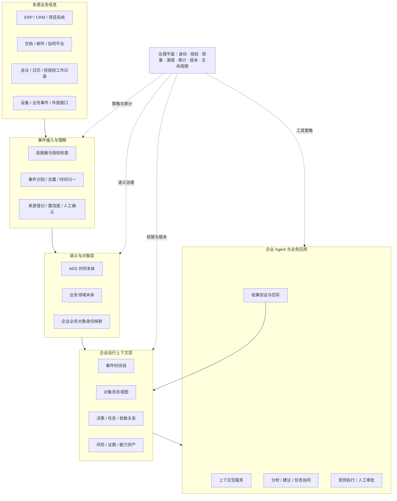

# 企业工作上下文基础设施与企业运行认知体系研究

> 从“记录企业发生了什么”走向“理解企业正在如何运行”：研究企业如何持续感知、关联、解释和治理业务活动，并以可靠的运行上下文支撑企业端口智能体。

| 项目 | 内容 |
|---|---|
| 文档编号 | ADS-WORK-02 |
| 版本 | V0.1-Research |
| 日期 | 2026-11-19 |
| 文档性质 | 专题研究与架构建议稿 |
| 关联研究 | ADS-WORK-01、ADS-12 V0.3、ADS-19 V0.4、ARCH-ADS-001 V1.0-Review |
| 研究范围 | 企业工作上下文、企业运行认知、上下文模型、参考架构、治理机制、试点路线 |
| 状态 | 研究假设与方案建议，待业务和架构评审 |

---

## 摘要：企业数智底座下一阶段要补上的能力

企业已经拥有 ERP、CRM、项目管理、财务、人力、即时通讯、文档和各类业务系统。这些系统记录了大量业务对象、流程节点和业务结果，但企业真实运行还包含大量分散在系统之间的活动与上下文：一项任务为何改变、一项决策如何形成、项目为什么延期、风险由谁发现、依赖关系何时发生变化、某个客户问题是否已经在其他项目出现，以及哪些经验已经被验证为可复用能力。

因此，企业数智底座的下一阶段不应只是继续增加数据接入和知识库容量，而应研究一种新的基础能力：**企业工作上下文基础设施（Enterprise Work Context Infrastructure）**。

它在企业既有业务系统之上，将经过授权的工作事件、业务对象、决策、任务、依赖、风险、证据和能力资产关联起来，形成带有时间、来源、责任、状态和权限边界的企业运行上下文。企业 Agent 不再只依靠孤立的文档检索或单次指令，而是在每项任务所需的最小上下文中理解当前状态、采取行动、记录结果并接受验证。

### 核心判断

1. **企业数智底座需要从“数据与知识承载”进一步发展为“企业运行上下文承载”。** 这不是替代原有数据库、业务系统或知识库，而是在它们之上建立关联、解释和状态理解能力。
2. **工作上下文不是原始活动数据的堆积。** 它是经过来源校验、语义映射、时间关联、权限判断和责任确认后形成的任务相关视图。
3. **企业运行状态必须区分事实、推断、冲突和未知。** AI 推断不能覆盖业务系统事实；上下文层应保留来源与置信度，并允许状态过期和争议存在。
4. **企业工作感知不是员工监控。** 只处理有明确业务目的、合法依据、组织规则和必要授权的工作信息，不以全员持续采集作为默认前提。
5. **Agent 的可靠性取决于上下文质量和治理机制。** Agent 应获得任务所需的上下文包，而不是默认读取企业所有数据。
6. **企业能力复用的核心对象是经过验证的流程、规则、模板和 Skill。** 个人记忆和未经验证的经验不能直接升级为组织标准。

---

## 1. 研究背景：从企业信息化到企业运行理解

### 1.1 传统系统记录了什么，又遗漏了什么

企业系统通常以业务对象和流程事务为中心：CRM 记录客户和商机，ERP 记录订单和资源，项目系统记录任务和里程碑，财务系统记录收入和成本，协同系统记录消息和文件。这些记录非常重要，但通常分散在不同系统中，语义、时间粒度、对象 ID、状态定义和权限模型并不一致。

企业实际运行还包含大量“连接性信息”：

- 任务从提出到完成期间发生了哪些变化；
- 决策形成时考虑了哪些约束、风险和替代方案；
- 一个问题与哪些客户、产品、项目、人员和资源有关；
- 项目延期是由单一任务、跨团队依赖还是外部条件造成；
- 一条客户反馈是否已在其他渠道、项目或版本中出现；
- 某个工作方法是否经过多次实践验证，适用于什么范围。

这类信息可能散落在会议、邮件、即时通讯、文档批注、项目记录和个人工作记忆中。只把它们汇总成文档，并不意味着企业已经理解了它们之间的关系。

### 1.2 从“有数据”到“有上下文”

可以把企业 AI 能力粗略分为四个递进层次：

| 层次 | 企业具备的能力 | 典型问题 |
|---|---|---|
| 数据可见 | 能查询业务系统和文件 | 数据在哪里？ |
| 信息可检索 | 能搜索文档、知识库和记录 | 哪些资料可能相关？ |
| 上下文可理解 | 能关联对象、事件、任务、决策和状态 | 这件事发生了什么、为什么、现在处于什么状态？ |
| 运行可协同 | 能基于受控上下文协助判断、执行、验证和改进 | 下一步应由谁采取什么行动，结果如何确认？ |

本研究聚焦第三层，并研究如何安全地支撑第四层。并非每个业务场景都需要达到完全自动执行；高风险动作仍应保留人工审批。

### 1.3 核心研究问题

1. 如何从分散系统和经授权的工作信息中识别企业相关事件？
2. 如何把事件关联到统一的企业业务对象和领域语义？
3. 如何形成“当前状态 + 历史变化 + 来源证据 + 未解决事项”的上下文？
4. 如何识别信息缺失、事实冲突、状态过期和责任不明确？
5. 如何为不同 Agent 提供任务范围内、权限正确、版本明确的上下文？
6. 如何将 Agent 的执行结果、人工判断和业务结果回写到正确责任底座？
7. 如何在不建立员工持续监控体系的前提下，获得足以改善业务的运行理解？

---

## 2. 与 ADS 三级数智底座的关系

本研究是企业数智底座能力的深化，不改变 ADS-12、ADS-19 和总体架构 V1.0-Review 已建立的三级责任边界。

### 2.1 三级底座在本研究中的分工

| 层级 | 本研究中的作用 | 典型内容 | 不承担的职责 |
|---|---|---|---|
| 个人数智底座 | 个人工作上下文的自主沉淀与管理 | 个人工作事件、个人记忆、个人任务和经授权的个人资产 | 不默认向企业开放个人完整记忆 |
| 企业数智底座 | 企业运行上下文的主要承载和治理主体 | 企业业务对象、工作事件、决策、任务、风险、证据、标准数据和能力资产 | 不将员工私人信息或原始录音无差别汇聚 |
| 业务领域中心数智底座 | 共同语义、联邦目录、跨域协同与治理 | ADS 共同本体、资产元数据、能力目录、授权协调、跨域任务和审计 | 不替代企业业务责任，也不成为企业原始数据总仓 |

### 2.2 企业数智底座的定位深化

企业数智底座可以理解为企业自己的“业务数据与知识基础设施”，并进一步增加“运行上下文能力”。

它至少包括：

- 企业业务系统与业务数据库；
- 企业知识库、文档和制度标准；
- 企业标准业务数据与领域本体映射；
- 企业工作事件与协同记录；
- 企业运行上下文模型和状态视图；
- 企业证据、能力与经验资产；
- 企业 Agent 使用的上下文服务和权限控制。

因此，企业工作上下文基础设施不是一个新的独立数据孤岛，而是企业数智底座内部的一组关键能力。它应引用或连接权威业务系统，避免无意义复制所有原始数据。

### 2.3 ADS 的作用

ADS 在三级协同中提供共同语义、身份与代表关系、授权协调、联邦资产目录、能力注册发现、跨域任务协同、审计与评价机制。企业仍然负责自身业务对象、数据质量、业务规则和专业验收。

**关键边界：** ADS 可以协调任务和语义，但不能因为智能体调用或跨域调度而自动获得企业数据所有权，也不能替企业业务负责人作出专业验收。

---

## 3. 核心概念：什么是企业工作上下文

### 3.1 定义

企业工作上下文，是在特定时间、业务范围和授权目的下，围绕一个任务、业务对象或决策所组织的、可追溯的相关事实、事件、状态、关系、证据、责任和未解决事项的集合。

它至少回答六个问题：

1. **发生了什么：** 事件、任务、决策和状态变化。
2. **涉及什么：** 项目、客户、产品、订单、流程、资源和人员角色。
3. **为什么发生：** 已确认的原因、约束、依据和相关决策。
4. **现在如何：** 当前状态、责任人、时间要求、依赖和风险。
5. **还缺什么：** 未确认信息、冲突、过期状态和待补证据。
6. **接下来能做什么：** 被授权的行动、候选方案、审批和验证要求。

### 3.2 企业工作上下文不等于什么

| 容易混淆的概念 | 区别 |
|---|---|
| 企业知识库 | 知识库以文档和知识条目为主；上下文还包含事件时间线、业务对象关系、动态状态和未解决事项 |
| 企业数据湖 / 数仓 | 数据平台擅长存储、整合和分析数据；上下文层进一步组织任务相关语义和状态解释 |
| 企业搜索 | 搜索返回相关内容；上下文需要解释内容与当前任务、对象和状态之间的关系 |
| 流程挖掘 | 流程挖掘分析事件日志中的流程模式；上下文层还需连接非结构化事件、决策依据、责任和实时状态 |
| 知识图谱 | 知识图谱表达实体和关系；企业运行上下文还必须强调时间有效性、来源、状态、授权和任务作用域 |
| 数字孪生 | 数字孪生通常针对物理或业务对象建立模型；企业运行上下文可以为数字孪生提供事件与业务解释，但不等同于完整孪生系统 |
| Agent Memory | Agent Memory 面向特定 Agent 的记忆；企业上下文是由企业责任方治理、可供多个获授权 Agent 使用的上下文资产 |

### 3.3 六类核心上下文

| 类型 | 关注内容 | 示例 |
|---|---|---|
| 执行上下文 | 任务、负责人、状态、期限、依赖、进展 | 项目某项交付为什么卡住 |
| 决策上下文 | 决策内容、参与角色、依据、约束、备选方案 | 某个需求为什么被暂缓 |
| 关系上下文 | 客户、项目、产品、团队、供应商和资源之间的关系 | 一个客户问题关联哪些产品版本 |
| 风险上下文 | 风险、信号、影响范围、责任人、处置状态 | 多个任务共同依赖同一未确认资源 |
| 资源上下文 | 人力、预算、设备、算力、时间和可用能力 | 某项目的关键资源冲突 |
| 能力上下文 | 流程、模板、Skill、适用条件、版本和验证结果 | 某类问题已验证的处理流程 |

---

## 4. 企业运行上下文模型：事件、对象、状态与证据

建议建立统一的企业工作上下文模型，而不是为每一种采集设备单独建立一套数据结构。

### 4.1 五类基础对象

1. **业务对象（Business Object）**：企业中的项目、客户、产品、订单、合同、工单、流程、团队、资源等。
2. **工作事件（Work Event）**：业务活动、状态变化、会议决策、问题发现、客户反馈、任务分配和结果验收等。
3. **状态（State）**：对象在特定时间的状态，以及状态变化的有效区间。
4. **证据（Evidence）**：支持某条事实或判断的原始记录、系统引用、文件、核验记录或人工确认。
5. **能力资产（Capability Asset）**：经过验证、版本化、明确适用范围的流程、规则、模板和 Skill。

### 4.2 建议的核心关系

- 事件发生于某个业务对象；
- 事件由某个角色或系统产生；
- 事件改变某个对象的状态；
- 决策基于某些证据和约束；
- 任务由某个责任主体承担；
- 任务依赖其他任务、资源或外部条件；
- 风险影响一个或多个业务对象；
- 能力资产适用于特定流程和任务；
- 结果由证据支持，并由责任主体确认。

关系应有类型、方向、有效时间和来源，不能只建立无语义的“相关”边。

### 4.3 工作事件的关键字段

| 字段 | 含义 |
|---|---|
| event_id | 全局或企业范围内唯一标识 |
| event_type | 决策、任务创建、状态变更、问题、风险、客户反馈等 |
| occurred_at | 事件实际发生时间 |
| observed_at | 系统观察或采集到事件的时间 |
| recorded_at | 事件写入系统的时间 |
| actor_ref | 人员、角色、系统或 Agent 引用 |
| object_refs | 涉及的业务对象引用 |
| action / change | 发生的动作或状态变化 |
| source_ref | 来源系统、文档、消息或设备记录引用 |
| evidence_refs | 支持事件的证据引用 |
| confidence / verification_status | 置信度和验证状态 |
| authorization_ref | 数据使用或共享的授权引用 |
| ontology_version | 采用的共同本体和领域本体版本 |
| sensitivity / purpose | 敏感级别和处理目的 |
| lifecycle_status | 候选、已确认、争议、失效、归档等 |

### 4.4 必须保留时间语义

建议至少区分：

- **发生时间（event time）：** 业务事件真实发生的时间；
- **观察时间（observed time）：** 系统何时感知到该事件；
- **记录时间（record time）：** 事件何时进入上下文系统；
- **有效时间（valid time）：** 某个状态或关系在业务世界中何时成立。

例如，项目负责人在周一发生变更，周三才录入系统。系统必须保留“周一生效、周三记录”，不能把两者混成一个时间戳。时间语义是还原业务历史、判断信息新鲜度和处理冲突的基础。

### 4.5 状态不能只有“真 / 假”

企业上下文层建议至少支持以下认知状态：

- **已确认（Confirmed）：** 由权威业务系统或责任人确认；
- **观察到（Observed）：** 来源中确实出现，但业务含义尚待确认；
- **推断中（Inferred）：** AI 根据多条信息推断，尚未被确认；
- **存在冲突（Conflicted）：** 多个可信来源给出不一致状态；
- **已过期（Stale）：** 超过该类信息的有效时间或刷新周期；
- **未知（Unknown）：** 当前证据不足，不能判断。

这可以防止 AI 把“会议中有人提到可能延期”误写成“项目已延期”，也避免把过期的 CRM 字段当作当前事实。

---

## 5. 参考架构：企业工作上下文基础设施

### 5.1 五个能力层与一个治理平面

**第一层：多源业务感知与连接**

连接企业业务系统、项目系统、CRM/ERP、文档、会议、日历、邮件、即时通讯、设备与经授权的工作记录。连接方式优先采用 API、事件订阅、系统导出和受控引用；不以全量抓取为默认方案。

**第二层：事件理解与标准化**

完成事件识别、实体解析、去重、时间归一、来源登记、置信度评估和候选事件确认。区分系统事实、人工确认和模型推断。

**第三层：企业语义与对象关联**

使用 ADS 共同本体和企业所接入业务领域的领域本体，将不同系统中的客户、项目、产品、任务和流程对象映射到可关联的语义对象。保留原系统 ID 和来源引用，不轻易取代权威系统主键。

**第四层：运行上下文与状态引擎**

围绕业务对象建立事件时间线、当前状态视图、决策链、任务依赖、风险关系和证据链。识别状态过期、信息冲突、缺失字段、未明确责任和异常依赖。

**第五层：上下文服务与 Agent 协同**

按任务、角色、用途和风险等级生成上下文包，供企业端口智能体查询、分析或申请执行动作。执行结果必须记录调用主体、使用的上下文版本、策略版本、动作和结果证据。

**横向治理平面：**

- 身份与代表关系；
- 角色、对象和属性级权限；
- 授权、用途限制和保留期限；
- 来源溯源与数据质量；
- 本体、映射和模型版本；
- 审计、撤回、纠错和争议处理；
- Agent 工具权限、人工审批和回滚策略。

### 5.2 逻辑架构示意

### 5.3 上下文包（Context Package）

不建议让 Agent 直接读取整个企业上下文图谱。每次任务应生成范围明确的上下文包，至少包括：

- 任务目标和调用主体；
- 相关业务对象及其权威来源；
- 当前状态与最后更新时间；
- 关键事件时间线；
- 相关决策、约束和依赖；
- 风险、冲突、未知项和待确认项；
- 支持结论的证据引用；
- 可用动作、权限和审批要求；
- 上下文、本体、数据和策略版本。

上下文包应遵循最小必要原则，按角色、任务、目的和时间窗口裁剪。Agent 只能使用包中明确授权的内容；若发现信息不足，应请求补充或转人工，而不是自行填补事实。

---

## 6. 与现有企业系统的关系：不取代权威系统

### 6.1 权威数据与上下文视图分离

企业上下文层应明确每类数据的权威来源。例如订单金额以 ERP 为准，客户主数据以 CRM 或主数据系统为准，项目任务状态以指定项目系统为准。上下文层可以整合和解释这些信息，但不能默默覆盖权威来源。

建议采用以下规则：

1. 每类关键业务属性登记权威来源和责任方。
2. 上下文层保留原系统对象 ID、更新时间和来源引用。
3. 多源冲突时展示冲突和来源，不擅自选择一个值覆盖其他值。
4. 对推断性字段明确标注推断状态、依据和置信度。
5. 对需要回写的字段，通过受控 API 或业务流程写回权威系统，并保留审批与审计。

### 6.2 连接策略

| 连接方式 | 适用场景 | 注意事项 |
|---|---|---|
| API 查询 | 获取当前权威业务状态 | 控制频率、权限和字段范围 |
| 事件订阅 / Webhook | 及时感知业务状态变化 | 处理重复、乱序、丢失和重放 |
| 定时同步 | 不支持事件订阅的旧系统 | 明确新鲜度和同步窗口 |
| 受控引用 | 文件、知识库或原始记录 | 访问时再次校验权限 |
| 人工确认录入 | 决策、经验和非结构化事项 | 记录确认人、时间和依据 |
| 批量导入 | 历史数据初始化 | 明确来源、质量和时间边界 |

### 6.3 防止形成新的数据孤岛

- 使用统一事件模型和语义映射规范；
- 保留源系统 ID 和原始引用；
- 采用开放、可迁移的数据格式；
- 目录只登记资产元数据和受控引用，不要求复制所有正文；
- 上下文层可替换，不把关键业务流程锁定在单一厂商或模型上。

---

## 7. 企业运行认知的关键能力

### 7.1 状态重建

从离散事件和权威系统数据中重建对象当前状态，同时保留状态变化历史。状态重建必须有来源、有时间和验证级别。

### 7.2 依赖与阻塞识别

识别任务之间、团队之间、资源之间的依赖关系。例如多个项目都等待同一审批或资源，系统可以提出共享瓶颈候选，但应由业务责任人确认。

### 7.3 决策脉络追溯

把决策与提出的问题、备选方案、约束、证据、参与角色和后续结果关联起来。这样企业不仅知道“决定是什么”，还能够在条件变化时判断原决策是否仍然有效。

### 7.4 风险信号聚合

从项目状态、客户反馈、任务延误、质量问题和资源冲突中识别风险信号。风险输出应区分已确认风险、模型提示和待核验线索，不应自动变成绩效结论。

### 7.5 信息缺口发现

识别业务对象缺少责任人、决策缺少依据、任务缺少截止时间、状态长期未更新、多个系统信息冲突等情况。系统可以发起补全请求，而不是假设缺失信息不存在。

### 7.6 能力沉淀与复用

从多次经过验证的业务实践中提取流程、模板、规则和 Skill，记录适用范围、依赖、版本、验证结果、失败边界和责任人。未经验证的个人经验只作为候选，不直接成为组织标准。

---

## 8. Agent 如何使用企业运行上下文

### 8.1 从“问答”到“任务上下文协同”

传统问答通常围绕用户提问检索材料。上下文驱动的 Agent 则先识别任务，再获取与任务相关的对象、状态、约束、证据和权限，最后决定是回答、建议、请求确认还是执行。

### 8.2 分级自治策略

| 风险等级 | 行为类型 | 建议控制 |
|---|---|---|
| 低风险 | 搜索、摘要、状态解释、提醒草稿 | 可在授权范围内自动完成，保留来源 |
| 中风险 | 创建任务草稿、提出资源协调建议、更新非关键字段 | 预览与人工确认后执行 |
| 高风险 | 财务承诺、合同变更、客户正式承诺、人员决策、关键生产操作 | 必须由有权限人员审批，必要时双人复核 |
| 禁止或不适用 | 超出授权目的、访问敏感个人信息、规避业务控制 | 阻断并记录审计事件 |

### 8.3 每次 Agent 执行都应可追溯

至少记录：调用者、Agent 身份、任务 ID、上下文包 ID、所用来源与版本、策略版本、工具调用、审批人、执行结果、错误和回滚情况。

### 8.4 反馈闭环

Agent 的建议和执行结果不能自动视为企业事实。需要区分：

- Agent 提出的候选建议；
- 人员接受、修改或拒绝的决定；
- 工具执行成功或失败的技术结果；
- 业务责任人确认的业务结果；
- 由结果验证后产生的能力改进候选。

---

## 9. 关键创新点

### 创新一：企业运行上下文层

在业务系统、企业知识资产和 Agent 之间建立统一的上下文层，把分散事件、对象、状态、证据和关系组织为任务相关视图。

### 创新二：企业工作事件账本

以可追溯事件作为业务变化的连接单位，形成企业工作过程的时间线，而不是依赖孤立文档或摘要。

### 创新三：状态可信度与不确定性治理

明确区分已确认、观察到、推断中、存在冲突、已过期和未知，避免 AI 把推测包装成事实。

### 创新四：任务级上下文包

为每个 Agent 任务生成权限受控、范围最小、来源明确、版本可追溯的上下文包，降低过度授权和上下文污染。

### 创新五：决策链与依赖图

把决策依据、约束、任务依赖和结果联系起来，让企业能够追溯“为什么这样做”，并在条件变化时重新评估。

### 创新六：企业能力的验证式沉淀

将反复实践中的有效方法转化为版本化能力资产，支持跨人员、跨团队和跨项目复用，同时记录不适用条件。

### 创新七：企业运行缺口的主动发现

不只是回答已有问题，还能发现信息过期、责任缺失、依赖阻塞和证据不足，并把这些问题转化为可处理的工作项。

---

## 10. 试点建议：从一个可观察的业务闭环开始

### 10.1 首选试点类型

建议优先考虑“项目交付与跨团队协同”或其他具有明确对象、任务、责任人、状态、依赖和结果的流程。原因是这类流程通常能在项目系统、会议记录、文档和协同平台之间观察到上下文断点，且可定义较清晰的业务结果。

这只是推荐的试点类型，不代表预设企业当前一定采用某套系统。最终应选择数据授权清晰、业务负责人明确、风险可控且能够形成对照组的流程。

### 10.2 最小闭环

1. 选择一个项目或流程，明确业务负责人和参与角色。
2. 接入一个权威业务系统和一类经批准的协同信息源。
3. 建立少量核心业务对象和事件类型，不追求全企业本体一次性建成。
4. 对事件做来源登记、去重、对象关联和人工确认。
5. 形成项目或流程的当前上下文视图：状态、决策、任务、依赖、风险、证据和未知项。
6. 让 Agent 只执行低风险动作，例如汇总状态、发现缺失信息、生成任务草稿。
7. 由业务负责人确认结果，并记录修订、拒绝和执行情况。
8. 与原有流程进行对照，评估业务价值和治理成本。

### 10.3 试点范围的排除项

第一阶段不建议：

- 全员、全时段持续采集音频或屏幕；
- 一次性接入全部企业 SaaS；
- 直接建设覆盖所有领域的完整企业知识图谱；
- 允许 Agent 自动进行高风险业务承诺；
- 把推断状态自动写回权威业务系统；
- 将工作上下文用于未经批准的个人绩效画像。

---

## 11. 验证指标与评估方法

| 维度 | 指标 | 建议定义 |
|---|---|---|
| 覆盖 | 关键事件覆盖率 | 抽样业务事件中被正确识别和关联的比例 |
| 语义 | 对象关联准确率 | 事件与项目、客户、产品、任务等对象关联正确的比例 |
| 时效 | 状态新鲜度 | 上下文状态距权威来源最近更新时间的时间差 |
| 可信 | 来源可追溯率 | 关键上下文结论能够追溯到来源和证据的比例 |
| 可信 | 冲突识别率 | 已知多源冲突中被系统识别并标注的比例 |
| 完整 | 上下文完整度 | 任务所需对象、状态、责任、依赖和证据字段的完整程度 |
| 运营 | 阻塞发现有效率 | 被业务负责人确认有价值的阻塞提示比例 |
| 运营 | 信息补全周期 | 从发现信息缺口到责任人补全的时间 |
| Agent | 建议采纳率 | 经业务人员审查后被接受或修改采纳的建议比例 |
| Agent | 受控执行成功率 | 在权限与审批约束下正确完成的动作比例 |
| 业务 | 周期时间、返工率、遗漏率 | 与原流程基线比较业务结果变化 |
| 治理 | 越权访问与错误写入 | 必须设置阻断目标的安全指标 |
| 成本 | 单流程上下文成本 | 连接器、模型、存储、人工核验和运维综合成本 |

评估时必须同时报告正向收益和负向成本。不能只报告 Agent 生成了多少摘要、识别了多少事件或节省了多少点击，而应确认业务结果是否改善、错误是否减少、人工核验是否可接受，以及治理成本是否合理。

---

## 12. 分阶段建设路线

### 阶段 0：业务边界与上下文建模

- 选定单一业务流程；
- 明确权威系统、对象、角色和数据责任；
- 定义事件类型、状态语义和核心指标；
- 确认采集、使用、保存和退出规则；
- 形成试点数据契约和治理评审记录。

**阶段门槛：** 业务负责人、数据责任人和安全责任人明确；数据来源与授权可说明。

### 阶段 1：事件接入与对象关联

- 接入一到两个必要数据源；
- 建立事件标准模型；
- 实现去重、时间语义、来源引用和对象映射；
- 区分观察、推断和确认状态；
- 建立人工纠错入口。

**阶段门槛：** 事件与对象关联质量达到预设要求，来源可追溯。

### 阶段 2：运行上下文视图

- 建立业务对象事件时间线；
- 形成当前状态、决策、任务依赖和风险视图；
- 识别过期、冲突、缺失和未知；
- 由业务负责人验证上下文是否符合真实运行情况。

**阶段门槛：** 上下文能帮助业务人员更快、准确地回答关键运行问题。

### 阶段 3：上下文驱动的 Agent

- 建立任务级上下文包；
- 先开放查询、解释、提醒和草稿生成；
- 对写操作增加人工审批和审计；
- 记录上下文版本、工具调用和结果证据。

**阶段门槛：** Agent 业务效果优于基线，且越权和错误写入控制有效。

### 阶段 4：跨流程能力复用

- 将多个流程的共性抽象为能力资产；
- 由业务或领域责任方审核；
- 明确适用条件、版本和失败边界；
- 在不同团队或项目中验证迁移成本和效果。

**阶段门槛：** 能力资产在新场景中经验证有效，而非只在原项目中表现良好。

以上周期和阶段为建议，不构成项目工期承诺。应根据企业现有系统、数据治理成熟度和业务风险调整。

---

## 13. 风险与治理原则

| 风险 | 典型表现 | 控制原则 |
|---|---|---|
| 监控化 | 将上下文能力用于员工持续监控或未经批准的绩效画像 | 目的限定、最小必要、透明告知、组织制度审查 |
| 事实混淆 | AI 推断被当作业务事实 | 认知状态分级、来源引用、人工确认 |
| 语义错误 | 不同系统中的同名对象被错误合并 | 对象身份治理、匹配置信度和人工核验 |
| 信息过期 | 旧状态被当成当前状态 | 新鲜度策略、有效时间、过期标记 |
| 权限扩张 | Agent 为方便执行而读取过多数据 | 任务级上下文包、最小权限、工具白名单 |
| 错误执行 | Agent 根据不完整上下文执行写操作 | 风险分级、审批、幂等、回滚和审计 |
| 组织抵触 | 员工担心信息被用于非预期用途 | 共同设计规则、明确禁用场景、可申诉和纠错 |
| 系统耦合 | 上下文层成为新的单体平台 | 标准事件模型、开放接口、源系统权威性 |
| 过度建设 | 先做全企业知识图谱，迟迟没有业务价值 | 从单流程最小闭环开始，按价值扩展 |

### 13.1 四条不可妥协的原则

1. **上下文不是事实的替代品。** 上下文层负责关联和解释，权威业务系统仍负责其定义范围内的事实记录。
2. **缺失不是否定。** 没有采集到某件事，不代表它没有发生；没有证据，不应自动推断为不存在。
3. **可见不等于可用。** 资产进入目录或上下文图谱，不代表任何 Agent 都有权读取或使用。
4. **自动化不等于自治。** Agent 的每种动作都应有明确权限、风险级别、审批条件和责任主体。

---

## 14. 与 ADS 既有架构研究的衔接

| 既有架构主题 | 本研究的承接方式 |
|---|---|
| ADS 共同本体与业务领域本体 | 为工作事件、业务对象、任务、决策、证据和能力提供共同语义锚点与专业语义 |
| 三级数智底座 | 企业运行上下文主要由企业数智底座承载；个人数据留在个人责任边界；中心侧通过联邦目录和治理协同 |
| ADS 执行端、管理端、考核端 | 执行端可调用受控上下文与 Agent；管理端治理对象、授权和能力；考核端评价任务质量、风险和改进结果 |
| 联邦资产目录 | 登记上下文资产、能力资产和标准数据的元数据、责任方、版本、授权与受控引用 |
| 证据与标准数据双轨 | 证据支持核验和追溯；经验证的标准数据供 Agent 运行 |
| 混合式部署 | 根据数据责任、敏感级别和业务时效，决定本地、企业私有环境或云端协同，不先验指定物理拓扑 |

本研究不新增第四级数智底座，也不把企业工作上下文基础设施定义为 ADS 之外的另一个中心平台。它是企业数智底座内部的能力体系，并通过 ADS 既有治理机制参与跨层协同。

---

## 15. 待评审问题

| 编号 | 待决策事项 | 需要确认的内容 |
|---|---|---|
| C-01 | 企业工作上下文是否作为企业数智底座的正式能力域 | 命名、边界、与企业知识库/数据平台的关系 |
| C-02 | 首个试点业务流程 | 业务价值、数据可得性、责任主体和风险 |
| C-03 | 企业工作事件标准 | 事件类型、时间语义、来源、置信度和状态模型 |
| C-04 | 企业业务对象身份映射 | 主数据来源、跨系统 ID、合并与拆分规则 |
| C-05 | 上下文状态权威规则 | 各业务字段的权威来源和冲突处理方式 |
| C-06 | Agent 上下文包标准 | 任务范围、最小字段、权限、版本和过期策略 |
| C-07 | 工作感知数据使用边界 | 可采集范围、员工知情、第三方信息和禁止用途 |
| C-08 | 自动化风险分级 | 哪些动作可自动、哪些需确认、哪些禁止 |
| C-09 | 能力资产发布机制 | 审核责任、适用范围、版本、兼容和回滚 |
| C-10 | 企业与中心层协同 | 哪些元数据进入联邦目录，哪些内容只保留在企业侧 |

---

## 16. 研究结论：企业数智底座需要具备“理解运行”的能力

企业数智底座的价值不应只用接入多少系统、存储多少文档、建设多少知识库或部署多少 Agent 来衡量。

更重要的是，它能否逐步形成对企业运行的可信理解：

- 知道企业有哪些关键业务对象；
- 理解对象之间如何关联；
- 看见业务活动和状态变化；
- 追溯决策、任务和结果的形成过程；
- 识别风险、依赖、冲突和信息缺口；
- 将经过验证的能力交给合适的 Agent 使用；
- 在授权和责任边界内推动执行、验证和持续改进。

因此，建议把企业数智底座的演进方向表述为：

**从企业数据与知识底座，发展为具备业务语义、工作上下文、运行状态理解和 Agent 协同能力的企业数智基础设施。**

这并不意味着一次性建成“全知企业大脑”，而是从一个业务流程开始，逐步形成可信、可解释、可治理、可扩展的企业运行认知能力。

### 近期最值得验证的命题

选择一个项目或业务流程，验证系统能否把分散在业务系统、会议和协同记录中的信息，形成准确的对象关系、事件时间线、当前状态、决策依据、任务依赖和未解决事项；再验证企业 Agent 是否能利用这个上下文减少遗漏、缩短处理周期，并保持可审计、可回滚和权限正确。

**如果这个最小闭环成立，企业数智底座就不再只是“存放企业数据和知识的地方”，而开始成为“持续理解企业如何运行、并在授权范围内帮助企业改善运行”的基础设施。**

---

## 17. 参考研究资料与边界

1. 《基于多源工作感知的个人与企业数智资产生成及协同机制研究》，ADS-WORK-01 V0.1-Research，2026-11-19。
2. 《个人—企业—生态中心三级数智底座：数据资源、标准数据、算力与能力回馈的矩阵架构》，ADS-12 V0.3，2026-11-03。
3. 《三级数智底座统一数据模型与资产目录：个人、企业、生态中心的资产分类、联邦目录与双向流转》，ADS-19 V0.4，2026-11-03。
4. 《AI Native 数智基础设施总体架构与混合式系统设计研究》，ARCH-ADS-001 V1.0-Review，2026-11-13。
5. 本项目关于 AI 工作感知、企业数智底座和 ADS 三级底座定位的讨论，2026-11。

> **版本声明：** 本文件为 V0.1 专题研究稿。企业工作上下文模型、指标、试点流程和治理要求均为研究建议，需经企业业务责任方、ADS 架构负责人、安全与合规负责人评审。本文不构成法律意见、员工监控方案、生产部署规格或已批准的工程设计。
