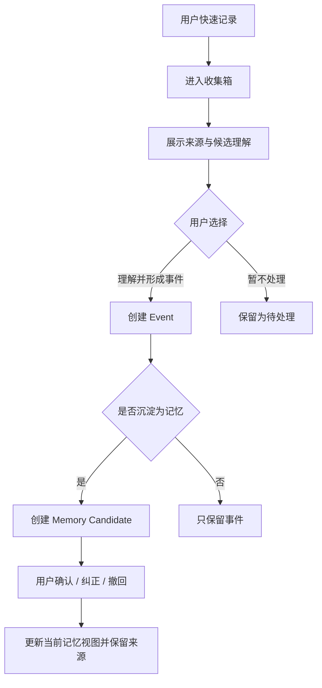
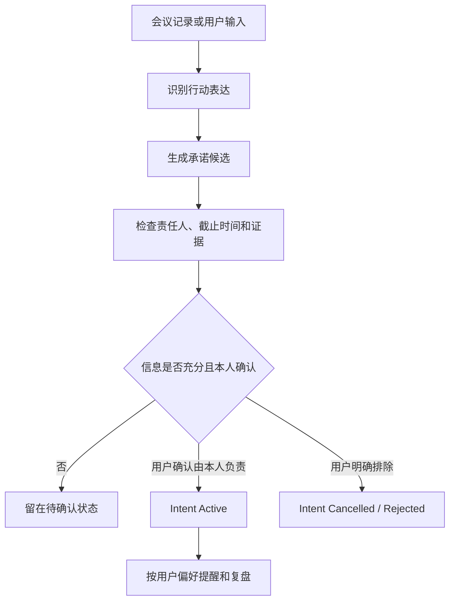
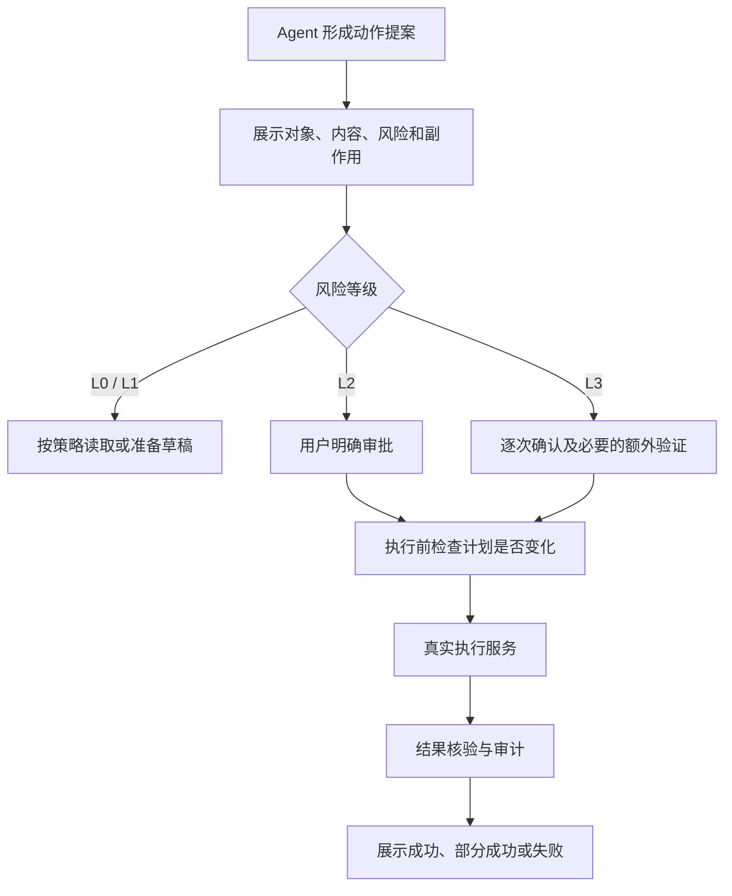

# ADS-WORK-10.1：Personal Assistant OS 可交互原型与研发验收规范

> 文档编号：ADS-WORK-10.1  
> 版本：V0.1 Prototype & Acceptance Specification  
> 日期：2026-11-19  
> 上游：ADS-WORK-08（语义与授权边界）、ADS-WORK-09（个人运行时）、ADS-WORK-10（产品体验架构）、PDKS—ADS 融合架构  
> 原型位置：`prototype/personal-assistant-os/`

---

## 0. 本次交付的定位

ADS-WORK-10.1 将 ADS-WORK-10 的产品设计转化为可操作、可评审、可测试的浏览器交互原型。

它验证的是**用户体验与产品规则**，不是生产级采集服务或 Agent 执行服务。

本次原型具备：
- 五大工作空间：今日、收集箱、时间线、目标与承诺、我的 AI；
- 30 天连续个人上下文模拟；
- 快速记录、候选事件形成和记忆沉淀；
- 记忆确认、纠正、撤回和历史版本保留；
- 目标、任务、承诺状态变更；
- 数据来源暂停、恢复和撤销；
- 通知偏好与自动化开关；
- Agent 动作预览、审批和拒绝；
- 演示会话 JSON 导出与重置；
- 本地交互逻辑单元测试和数据契约测试。

### 0.1 明确的非生产边界

| 能力 | 当前原型状态 |
|---|---|
| 真实钉钉、日历、文档连接 | 未连接，只有虚构来源数据 |
| 麦克风和真实录音 | 未实现，语音入口使用示例转写文本 |
| AI 模型推理 | 未接入，使用固定演示内容和规则 |
| 数据库与跨设备同步 | 未实现，状态仅存在当前浏览器会话 |
| 真实通知和定时任务 | 未执行，仅展示自动化配置 |
| 真实 Agent 工具调用 | 未实现 |
| 任务创建、消息发送、企业投影 | 不执行 |
| 真实数据删除服务 | 未实现；界面仅模拟记忆状态变化 |

不得把审批成功描述为外部任务已经创建，也不得把演示数据描述为真实用户记忆。

---

## 1. 产品体验目标与成功标准

### 1.1 核心体验目标

用户无需学习本体、Schema、标签和记忆管理方法，就能完成：

1. 随手记录一段内容；
2. 看到 AI 如何理解以及依据来自哪里；
3. 决定是否形成事件、记忆或承诺；
4. 回看过去 30 天的连续上下文；
5. 纠正错误或撤回不想继续使用的记忆；
6. 查看来源授权和自动化状态；
7. 了解 Agent 准备执行的动作，并决定是否批准。

### 1.2 北极星指标

**在不增加用户维护负担的前提下，减少重要事情遗漏、缩短信息找回时间、提升承诺推进质量，并建立用户对记忆与执行边界的信任。**

不以录音时长、采集量、记忆条数或通知数量作为唯一成功指标。

---

## 2. 信息架构与页面职责

| 页面 | 用户问题 | 页面职责 | 主要动作 |
|---|---|---|---|
| 今日 | 今天我需要关注什么？ | 今日摘要、日程、重要变化、待确认、Agent 待审批 | 快速记录、查看依据、审批 |
| 收集箱 | 我刚记录的内容在哪里？ | 接住文字、分享和语音转写，展示待理解内容 | 理解形成事件、暂不处理、沉淀记忆 |
| 时间线 | 最近发生了什么？ | 以时间展示工作、生活、学习事件及其来源 | 按日期、类别和关键词筛选 |
| 目标与承诺 | 我正在推进什么？ | 目标、任务、承诺、截止时间、下一步与阻塞 | 确认责任、完成、暂停 |
| 我的 AI | AI 了解我什么、能做什么？ | 记忆、来源、权限、自动化和纠错控制 | 确认、纠正、撤回、暂停、撤销 |

聊天和快速入口是全局能力，不形成第六个孤立知识空间。

### 2.1 今日页面

必须包含：
- 当日日期和简洁问候；
- 最多少量高价值关注项；
- 接下来日程；
- 待确认候选；
- Agent 动作待审批；
- 快速记录入口；
- 目标进展摘要；
- 30 天连续上下文入口；
- 个人数据边界说明。

没有重要变化时，应展示“暂无需要特别处理的事项”，不能制造虚假紧急提醒。

### 2.2 收集箱

内容状态：
- `needs_review`：等待用户查看或理解；
- `processed`：已形成事件；
- `dismissed`：用户暂不处理。

从收集箱形成事件时必须：
- 生成独立 event ID；
- 保留原始内容和来源引用；
- 保留观察时间与记录时间；
- 将推断标记为 candidate / inferred；
- 不因形成事件自动创建正式承诺。

沉淀为长期记忆必须单独执行，并进入候选或待确认状态。

### 2.3 时间线

- 30 天范围可逐日浏览；
- 工作、生活、学习分类筛选；
- 支持当天关键词搜索；
- 事件展示发生时间、来源、状态和可信度；
- 空白日期不伪造事件；
- 里程碑是体验叙事，不代表系统推断的确定事实。

### 2.4 目标与承诺

- 目标、任务、承诺、例程分开展示；
- inferred_candidate 不能直接进入 active；
- 责任人未确认时显示“待确认”；
- 用户确认后才变成正式个人承诺；
- 用户可明确排除责任；
- 完成和暂停必须有状态反馈；
- 来源事件不可丢失。

### 2.5 我的 AI

包含四个子页签：
1. AI 记住的；
2. 数据来源；
3. 权限与隐私；
4. 自动化。

记忆操作必须支持确认、纠正、撤回；纠正应保留旧版本的历史关系。来源支持暂停、恢复和撤销；已撤销授权不能直接恢复。自动化开关只改变本地演示状态。

---

## 3. 端到端关键用户旅程

### 3.1 快速记录 → 事件 → 记忆



关键规则：
- Event 与 Memory 是不同对象；
- Memory 必须引用来源事件；
- 自动推断不得静默变成 confirmed；
- 用户撤回后不能由后续自动整理静默恢复。

### 3.2 会议表达 → 承诺候选 → 用户确认



“讨论过”不等于“承诺了”；“某人说了”不等于“用户负责”；“AI 推断”不等于“事实”。

### 3.3 Agent 提案 → 审批 → 执行



本原型只实现提案展示、审批选择和状态反馈，不调用真实执行服务。

---

## 4. 交互状态与动作契约

| 对象 | 状态 | 允许操作 | 禁止行为 |
|---|---|---|---|
| Inbox Item | needs_review | 形成事件、暂不处理 | 静默转成正式承诺 |
| Event | observed / inferred / confirmed | 查看来源、纠正、关联 | 覆盖原始来源 |
| Memory | candidate | 确认、纠正、撤回 | 未确认就作为稳定事实 |
| Memory | confirmed | 查看、纠正、撤回 | 无证据静默覆盖 |
| Intent | inferred_candidate | 确认本人负责、明确排除 | 自动变成 active |
| Intent | active | 完成、暂停、更新下一步 | 丢失来源事件 |
| Source | connected / paused | 暂停、恢复、撤销 | 撤销后无新授权直接恢复 |
| Agent Action | pending approval | 查看、批准、拒绝 | 计划变化后沿用旧审批 |
| Automation | on / off | 开启、关闭 | 隐藏触发条件或通知方式 |

### 4.1 记忆纠错规则

- 原记忆标记 superseded；
- 新记忆引用相同来源并保留 supersedes 关系；
- 新记忆只有在用户明确纠正后才作为 confirmed；
- 旧记忆仍可审计，但不能作为当前上下文默认使用。

### 4.2 记忆撤回规则

本地原型将记忆状态设为 withdrawn。生产系统还必须执行：
- 检索过滤；
- 派生记忆抑制；
- 向量索引和缓存撤回；
- 相关 Agent Context Package 失效；
- 连接器下游用途和企业投影检查；
- 删除处理状态回执。

界面状态变更不等于真实删除完成。

### 4.3 来源撤销规则

- 暂停：停止后续同步，可由用户恢复；
- 撤销：撤回授权，停止后续同步；
- 已撤销：不能通过简单恢复按钮重新启用，必须重新授权；
- 撤销不自动证明历史数据已全部删除；
- 删除历史数据需要独立的数据处理服务和回执。

### 4.4 Agent 审批规则

审批卡片必须展示：
- 风险等级；
- 操作类别；
- 目标对象；
- 完整内容预览；
- 外部副作用；
- 可撤销性；
- 审批有效期；
- 来源和 Context Package。

L2/L3 必须明确审批。审批与执行是两个状态；审批成功不代表执行成功。

---

## 5. 视觉与交互设计系统

### 5.1 视觉基调

- 方向：克制、可信、轻量、专业；
- 主色：深蓝灰，用于结构和可信感；
- 辅色：蓝绿，用于正常状态和积极反馈；
- 警示：暖琥珀，用于待确认；
- 高风险：低饱和红，用于拒绝、撤销和高影响动作；
- 背景：浅灰白，卡片层级清晰；
- 圆角：卡片 12—16px，控件 8—10px；
- 动效：短时、轻量；支持 prefers-reduced-motion。

### 5.2 信息密度

- 首页仅展示少量优先项；
- 详情页再展开来源和上下文；
- 元数据弱化，核心事实突出；
- 状态标签使用文字，不只依赖颜色；
- 空状态说明下一步，不制造虚假内容；
- 手机端优先保留核心动作，不缩小桌面复杂表格。

### 5.3 可访问性

- 所有按钮可键盘访问；
- 对话框具有 dialog 语义；
- 状态变化通过 aria-live 反馈；
- 颜色之外提供文字状态；
- 支持窄屏布局；
- 支持减少动态效果。

---

## 6. 数据契约与来源映射

### 6.1 复用已有标准

| 产品对象 | 现有 ADS 标准 |
|---|---|
| 今日首页摘要 | ADS Personal Assistant Daily Brief |
| Event | ADS Personal Event Ledger |
| Memory | ADS Personal Memory Item |
| Goal / Task / Commitment | ADS Personal Intent Object |
| Agent Action | ADS Personal Agent Action Proposal |
| 个人数据表达 | PDKS 0.1 |
| 语义和授权边界 | ADS-WORK-08 |

本专题不另造一套替代 PDKS / ADS-WORK-08 / ADS-WORK-09 的个人核心数据模型。演示数据集仅用于产品体验组合。

### 6.2 来源溯源

每条可见事件、记忆、承诺或建议都必须能够回溯：
- 来源系统；
- 原生记录 ID；
- 采集模式；
- 授权引用；
- 发生时间；
- 观察时间；
- 处理时间；
- 断言状态；
- 置信度。

### 6.3 个人与企业边界

默认：
- `default_scope=personal_only`；
- `projection_allowed=false`；
- 不因工作来源就自动把个人记忆投影到企业；
- 企业投影必须独立授权、目的绑定、字段最小化、接收方明确且可撤回。

---

## 7. 原型工程结构

```text
prototype/personal-assistant-os/
├── index.html       # 产品壳与语义化页面结构
├── styles.css      # 响应式视觉系统
├── demo-data.js    # 浏览器本地演示数据
├── core.js         # 无外部副作用的交互领域逻辑
├── core.test.js    # Node 内置测试
└── README.md       # 运行方式与限制

examples/
└── ads-personal-assistant-os-demo-v0.1.json

schemas/
└── ads-personal-assistant-os-demo-v0.1.schema.json
```

原型不依赖第三方前端库。打开 `index.html` 即可体验；通过静态 HTTP 服务访问时也可正常运行。

### 7.1 会话与数据

- 样例数据为虚构内容；
- 状态修改只在当前页面会话内存中；
- 刷新页面恢复初始数据；
- 可导出本次演示会话 JSON；
- 不调用网络 API；
- 不写入浏览器持久化存储；
- 不读取麦克风或系统文件。

---

## 8. 后端研发接口建议

以下是下一阶段建议的服务边界，不代表当前已经实现。

| 方法 | 路径 | 用途 | 主要治理要求 |
|---|---|---|---|
| POST | /v1/personal/captures | 接收用户主动记录 | 身份、授权、幂等、来源保留 |
| GET | /v1/personal/today | 获取今日上下文 | 用户范围、来源可追溯 |
| GET | /v1/personal/events | 查询个人事件 | 分页、时间范围、分类过滤 |
| GET | /v1/personal/memories | 查询个人记忆 | 生命周期、敏感级别、来源 |
| POST | /v1/personal/memories/{id}/confirm | 确认记忆 | 仅所有者可操作 |
| POST | /v1/personal/memories/{id}/correct | 纠正记忆 | 版本关系、历史保留 |
| POST | /v1/personal/memories/{id}/withdraw | 撤回记忆 | 派生索引与缓存传播 |
| GET | /v1/personal/intents | 查询目标和承诺 | 候选与确认状态分离 |
| POST | /v1/personal/intents/{id}/confirm | 确认承诺 | 责任人明确确认 |
| GET | /v1/personal/sources | 查看数据来源 | 权限范围透明 |
| POST | /v1/personal/sources/{id}/pause | 暂停来源 | 停止增量同步 |
| POST | /v1/personal/sources/{id}/revoke | 撤销授权 | 停止同步、下游撤回 |
| GET | /v1/personal/agent-actions | 查看动作提案 | 风险、计划、上下文完整 |
| POST | /v1/personal/agent-actions/{id}/approve | 审批动作 | 计划哈希绑定、有效期 |
| POST | /v1/personal/agent-actions/{id}/reject | 拒绝动作 | 审计记录 |

真实接口应通过统一 API Gateway、Identity、Consent、Policy、Audit 和 Data Lifecycle 服务实现。不得由前端直接持有外部系统凭据。

---

## 9. 验收标准

### 9.1 产品验收

- [ ] 五个工作空间可切换；
- [ ] 今日首页显示摘要、日程、待确认和待审批；
- [ ] 收集箱可以新增内容；
- [ ] 收集箱内容可以形成事件；
- [ ] 事件保留来源引用；
- [ ] 事件可以沉淀为候选记忆；
- [ ] 记忆可以确认、纠正和撤回；
- [ ] 纠正后旧版本保留为历史；
- [ ] 时间线可以浏览 30 天；
- [ ] 时间线可以按日期、类别和关键词筛选；
- [ ] 目标、任务和承诺可以查看状态；
- [ ] 推断承诺必须经过用户确认；
- [ ] 来源可以暂停、恢复和撤销；
- [ ] 已撤销来源不能直接恢复；
- [ ] 隐私偏好可以交互调整；
- [ ] 自动化可以开启和关闭；
- [ ] Agent 动作可以查看完整预览；
- [ ] L2/L3 必须经过明确审批；
- [ ] 审批不会在演示环境产生真实外部写入；
- [ ] 会话可导出 JSON；
- [ ] 可以重置演示。

### 9.2 工程验收

- [ ] Demo JSON 符合 JSON Schema；
- [ ] 30 天日期连续且顺序正确；
- [ ] 所有来源引用可解析；
- [ ] 所有记忆和 Intent 来源事件可解析；
- [ ] 推断候选不自动成为 confirmed / active；
- [ ] L2/L3 初始动作均要求审批；
- [ ] 个人上下文默认仅个人；
- [ ] HTML 引用的静态资源全部存在；
- [ ] JavaScript 语法检查通过；
- [ ] Node 交互逻辑测试通过；
- [ ] Python Schema 和产品契约测试通过；
- [ ] GitHub Actions 全部通过。

### 9.3 不作为本轮验收内容

- 真实钉钉、日历、邮件和文档接入；
- 真实录音、转写和模型理解；
- 真实数据库和多端同步；
- 生产级身份认证、加密、授权撤回和删除传播；
- 真实通知、定时任务和 Agent 执行；
- 企业投影和跨组织数据流。

这些需要独立的架构、安全、隐私和业务系统评审。

---

## 10. 研发分阶段路线

| 阶段 | 交付 | Go / No-Go |
|---|---|---|
| P0 原型评审 | 五大页面与完整用户旅程 | 普通用户无需解释即可完成核心操作 |
| P1 个人记录服务 | Capture API、来源登记、事件账本 | 幂等、来源可追溯、授权有效 |
| P2 记忆与 Intent | Memory Compiler、Intent Manager | 候选与确认状态正确分离 |
| P3 多源只读连接 | 日历、文档、协作来源 | 最小范围授权、暂停和撤销可靠 |
| P4 主动服务 | 每日摘要、承诺提醒、变化提示 | 有用提醒率达标且打扰率可控 |
| P5 受控 Agent | Planner、审批、工具网关、执行核验 | L2/L3 审批和审计通过安全评审 |
| P6 多端与离线 | 手机、桌面、Web、可选语音终端 | 同步冲突、撤销传播和删除链路通过验收 |

---

## 11. 30 天试点研究设计

原型中的 30 天是虚构体验旅程，不是用户研究结论。真实试点建议采用小范围、自愿参与、透明告知的方式。

### 第 1 周：让系统先理解

- 用户主动快速记录；
- 选择一个只读来源；
- 检查事件是否准确；
- 收集首周价值和使用成本。

### 第 2 周：形成记忆

- 查看候选记忆；
- 允许用户确认和纠错；
- 检查来源引用是否足够清楚；
- 观察用户是否理解个人数据边界。

### 第 3 周：帮助推进事情

- 识别承诺候选；
- 确认责任人；
- 提醒已确认承诺；
- 记录无用提醒和打扰反馈。

### 第 4 周：评估信任与连续性

- 复盘 30 天时间线；
- 检查过期和冲突记忆；
- 测试来源暂停与撤销；
- 测试 Agent 审批理解；
- 对比用户开始使用前后的整理成本和遗漏情况。

### 试点指标

| 指标 | 计算方式 |
|---|---|
| 首次价值时间 | 从开始使用到获得第一条有用回顾的时间 |
| 事件准确率 | 人工核验正确事件 / 抽样事件 |
| 记忆确认率 | 用户确认记忆 / 用户审核记忆 |
| 承诺识别准确率 | 人工核验正确候选 / 抽样候选 |
| 提醒有用率 | 用户认为有帮助的提醒 / 被评价提醒 |
| 错误提醒率 | 不准确或不应提醒的提醒 / 被评价提醒 |
| 纠错成功率 | 用户纠正后未再以旧值误用的比例 |
| 用户维护耗时 | 用户用于整理和维护的时间 |
| 信任理解度 | 用户能否说清来源、权限、删除和审批边界 |

不能为了提高指标而增加不必要采集、提醒或确认次数。

---

## 12. 本轮交付清单

- [交互式原型入口](../prototype/personal-assistant-os/index.html)
- [设计 Token](../prototype/personal-assistant-os/design-tokens.json)
- [原型使用说明](../prototype/personal-assistant-os/README.md)
- [交互领域逻辑](../prototype/personal-assistant-os/core.js)
- [交互逻辑测试](../prototype/personal-assistant-os/core.test.js)
- [30 天虚构演示数据](../examples/ads-personal-assistant-os-demo-v0.1.json)
- [30 天试点评估模板](../pilot/个人助理OS30天试点评估模板.csv)
- [用户访谈提纲](../pilot/个人助理OS用户访谈提纲.md)
- [演示数据 JSON Schema](../schemas/ads-personal-assistant-os-demo-v0.1.schema.json)
- [ADS-WORK-10 产品研究报告](./10-个人数智底座的产品形态多终端感知入口与个人助理OS交互架构研究.md)

---

## 结论

ADS-WORK-10.1 的完成标准不是“有五个页面”，而是用户能够亲自走通：

**记录 → 理解 → 形成事件 → 沉淀记忆 → 确认承诺 → 获得提醒 → 审批动作 → 查看结果 → 纠错和撤回。**

这条链路必须在产品上自然、在数据上可追溯、在权限上可控制、在执行上可审计。

产品可以逐步变聪明，但不能逐步拿走用户的控制权。
